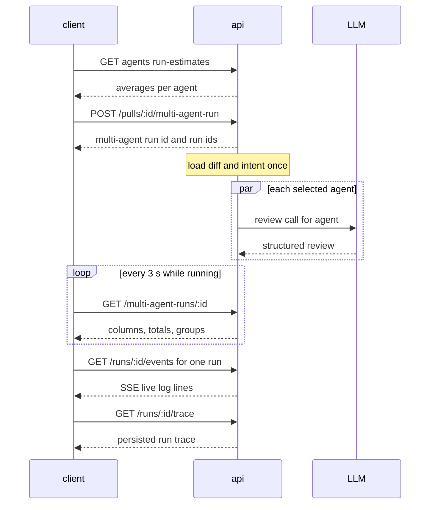
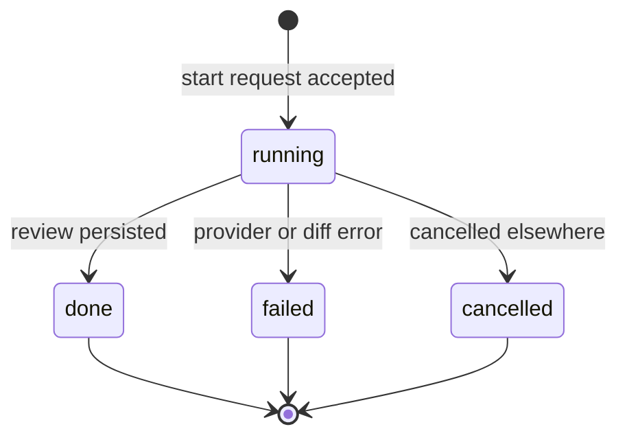

# Spec: Multi-Agent Review — pick agents, fan them out in parallel on one PR, compare their findings side by side
Spec ID: SPEC-08
Status: approved
Supersedes: none. The PR page "Run Review" dropdown changes from "Run all enabled agents" plus single-agent items (`RunReviewDropdown.tsx:51-82`) to a multi-select agent picker; no spec governed the old dropdown. SPEC-04's Non-goal "Learn / Reply to author" (`specs/SPEC-04-eval-pipeline.md:124`) stands: Learn renders here as a disabled control and neither action is built.

## Problem and user

A reviewer who wants several specialised agents on one pull request has to start them one by one from the PR page, or use "Run all enabled agents" (`RunReviewDropdown.tsx:72-77`). "Run all" runs every enabled agent **one after another**, because `executeRuns` awaits each agent in a `for` loop (`server/src/modules/reviews/run-executor.ts:139-166`). Three agents take roughly the sum of their durations. Their findings sit in separate accordions, and nothing shows:

- where two agents agree;
- where one agent flagged a location and another did not;
- what a run will cost before it starts.

The fan-out is not even recorded as one unit. `agent_runs` has no batch id (`server/src/db/schema/runs.ts:19-51`), and `multi_agent_runs` exists without any inbound link (`runs.ts:105-114`).

The users:

- **The reviewer.** They pick a PR and agents, see an estimate, run the agents in parallel, then compare per-agent columns and "where agents disagree".
- **The person paying for model calls.** They want an estimate before the run and the real totals after it. One agent's failure must not waste the others' spend.
- **The agent author.** They want each agent's run trace (tokens, cost, grounding decisions) and triage on the same screen.

## Goals / Non-goals

**Goals**

- **A checkbox agent picker in the PR page "Run Review" dropdown** (`1.png`).
- **A Configure run screen at `/multi-agent`** (`2.png`, `3.png`). It has a PR select, agent cards with a time · cost estimate from past runs, Select all, and a footer estimate.
- **A multi-agent run parent** that owns the agent runs it starts.
- **Concurrent execution of every review run.** The diff and intent are prepared once, and failures are isolated per agent.
- **A results page at `/multi-agent/<id>`** with two modes:
  - Columns: live per-agent state, score, time, cost, findings, View trace.
  - Tabs: a summary card plus the existing `FindingCard`, with a disabled Learn.
- **Finding groups** built with the repo's existing location rule `findingMatches` (`server/src/modules/eval/helpers/scoring.ts:50-65`). The original findings and their authors stay intact.
- **"Where agents disagree"** with every agent's take per group, including "did not flag", and a `Show only conflicts` toggle.
- **The existing `RunTraceDrawer`**, opened from every agent's View trace.
- **A "Multi-Agent Review" sidebar item.**

**Non-goals** (each is a decision; do not "restore" it)

- **Cancel per column and "Cancel all" on the results page** (S2). The existing cancel on the PR page stays untouched.
- **A "multi-agent run already in progress" guard (409)** (S3). Only the pending-request button disable is built.
- **"Also flagged by" chips** (S5). Grouping is visible in "Where agents disagree".
- **Rationale-derived take notes** (S4). The note is the finding title.
- **Reasons for "did not flag"** — agents emit findings only (`data.jsx:444-451` shows invented reasons).
- **Similarity-based or range-capped grouping.** Only `findingMatches` is used.
- **URL state for the Columns/Tabs mode and for the selected agents** (S6). Only `?pr=` and `?trace=` live in the URL.
- **Medians or other estimate statistics** (S9). A plain average is used.
- **A "repository has no pull requests" empty state** (S10). The select is simply empty.
- **A full history page of multi-agent runs.** Only the selected PR's 5 most recent runs are listed on the Configure run screen (AC-43), as the way back to a results page (rev. 2026-10-10).
- **A per-agent timeout.**
- **Per-agent stored colour or icon.** A palette by index and the `Cpu` icon are used instead.
- **Reply to author** (`5.png`; SPEC-04 `:124`) and a working **Learn** action (the server rejects `learn`, `server/src/modules/reviews/findings.ts:22-33`).
- **The other GLOBAL sidebar items** (Memory, Agent Performance, CI Runs; SPEC-02 `:77-79`).
- **"fan-out via worktrees" / "via p-queue" wording.** Neither is true of this server.
- **Fixing the missing workspace check on `GET /runs/:id/events`** (`server/src/modules/reviews/routes.ts:55-61`) — it predates this feature (Open questions 1).
- **Anything in `ci/`, `agent-runner/` or `reviewer-core/`.**

## User stories

- **US-1** As a reviewer on a PR page, I want to tick agents and start them in one click, so that I do not start each agent separately.
- **US-2** As a reviewer, I want a Configure run screen with a time and cost estimate, so that I know the cost before I spend.
- **US-3** As the person paying, I want the agents to run in parallel with isolated failures, so that the wall-clock is close to the slowest agent and one failure does not waste the rest.
- **US-4** As a reviewer, I want each agent's state live in its own column, so that I know who is working, who is done and who failed.
- **US-5** As a reviewer, I want findings of different agents at one location grouped, with each original finding and its author still visible, so that I see agreement without losing attribution.
- **US-6** As a reviewer, I want a "Where agents disagree" block with a conflicts-only filter, so that I can focus on contested code.
- **US-7** As an agent author, I want to open any agent's run-trace panel from the results page, so that I can see its live log, configuration, stats, prompt and raw output, and why it failed.
- **US-8** As a reviewer, I want to accept, dismiss and turn findings into eval cases in the Tabs view, so that triage happens where I compare.
- **US-9** As a workspace owner, I want every multi-agent read and write confined to my workspace, so that another tenant's runs and findings are never exposed.
- **US-10** As the course author, I want a recorded 1-agent vs 3-agent measurement, so that the real ratio is known instead of assumed.
- **US-11** As a reviewer who left a results page, I want to get back to a recent or still-running multi-agent run of a PR from the sidebar, so that I do not need its URL (rev. 2026-10-10).

## Acceptance criteria (EARS)

### A. Pickers (PR page dropdown and Configure run screen)

**AC-1 [client]** WHEN the user opens "Run Review" on the PR page, the dropdown shall show, under the header "Pick agents to run":
- a "Clear" action that unchecks every row;
- one checkbox row per enabled agent, in agents-list order, every row checked on open, disabled agents omitted;
- the `Run multi-agent review (N)` button;
- "Configure agents…", linking to `/agents`.

The dropdown has no "Run all enabled agents" item and no single-agent item. On a merged or closed PR, the existing merged warning row (`RunReviewDropdown.tsx:66-71`) stays above the rows (`1.png`).
Verify: unit — with 3 enabled agents and 1 disabled agent, 3 checked rows render, and Clear unchecks them. The removed items are absent, and the merged warning renders with `warnMerged`.

**AC-2 [client]** IF the workspace has no enabled agent, THEN the dropdown shall show one muted item "No enabled agents — configure agents" linking to `/agents` in place of the rows and the run button.
Verify: unit — the item renders, and there is no checkbox and no run button.

**AC-3 [client]** The route `/multi-agent` shall render:
- the heading "Run a Multi-Agent Review";
- step 1 "Pull request", a select listing the active repository's PRs as `#{number} · {title}`, preselected from `?pr=<pr id>` when given;
- step 2 "Agents to run" (`2.png`).
Verify: unit — the heading, both steps and one option per mocked PR render, and `?pr=` preselects that PR.

**AC-4 [client]** WHILE no pull request is selected, step 2 shall show the empty state "Pick a pull request first" with the body "Choose which PR to review above, then select the agents to run on it." (`2.png`).
Verify: unit — the empty state renders and no agent card renders.

**AC-5 [client]** WHEN a pull request is selected, step 2 shall show a "Select all" action and one checked card per enabled agent. Each card has a checkbox, the `Cpu` icon, the agent name, the agent's description and its estimate (`3.png`).
Verify: unit — one checked card per mocked enabled agent, with its name and description. After unchecking one, Select all checks it again.

**AC-6 [client]** IF the workspace has no enabled agent, THEN `/multi-agent` shall show the empty state "Enable agents to run reviews" with a "Go to Agents" link to `/agents` (`screen_multiagent.jsx:95-96`).
Verify: unit — the empty state and link render, and there is no PR select.

**AC-7 [client]** Both pickers' run buttons shall read `Run multi-agent review (N)`, with N the number of checked agents, and be disabled while N is 0, while no PR is selected (Configure run), or while a start request is pending (S3; fixes `2.png`, which shows "(4)" enabled with no PR).
Verify: unit — the label tracks the checkboxes. The button is disabled at N = 0, with no PR, and during a never-resolving request, where a second click sends nothing.

**AC-8 [client]** WHEN the user clicks an enabled run button, the client shall send exactly one `POST /pulls/:id/multi-agent-run` whose `agent_ids` are the checked agents' ids.
Verify: unit — the mocked API records one call with exactly those ids and no `POST /pulls/:id/review`.

**AC-9 [client]** WHEN a start request from either picker succeeds, the client shall navigate to `/multi-agent/<id>` of the returned multi-agent run.
Verify: unit — the router receives that path from both pickers.

**AC-10 [client]** The pickers shall display estimates from the estimates read (AC-11):
- per agent, `~{seconds}s` in the dropdown and `{duration} · {cost}` on a card, each part `—` when its average is null;
- in the footer, `≈ {time} · {cost} · parallel fan-out`. Time is the maximum average duration among the selected agents that have one (`—` if none). Cost is the sum of the known average costs of the selected agents, followed by `+` when at least one selected agent's average cost is null. It is `—` only when none is known (`3.png`; rev. 2026-10-10, user feedback: a single agent without history hid the whole total).
Verify: unit — table-driven: all known, one null duration, all null durations, one null cost, all null costs. For example:
- 8 200 / 7 400 ms and $0.06 / $0.05 give `≈ 8.2s · $0.11 · parallel fan-out`;
- $0.06 / null give `$0.06+`.

### B. Server — estimates and starting a run

**AC-11 [server]** WHEN estimates are requested for a set of agent ids, the system shall return per agent:
- `runs_sampled` — that agent's newest `status = 'done'` runs in the workspace, at most 10;
- `avg_duration_ms` — their average `duration_ms`, or null when `runs_sampled` is 0;
- `avg_cost_usd` — the average of their non-null `cost_usd`, or null when none has one (S9).
Verify: integration — with 12 done runs plus failed runs, the averages equal those of the newest 10 done runs. A fresh agent returns `0 / null / null`, and runs with only null costs give a null cost average.

**AC-12 [server]** WHEN `POST /pulls/:id/multi-agent-run` is valid, the system shall create one multi-agent run for that PR and exactly one agent run per distinct requested agent id, each belonging to that multi-agent run.
Verify: integration — `agent_ids` [a, b, a] yields one parent and two agent runs, both returned by `GET /multi-agent-runs/:id`.

**AC-13 [server]** WHEN the start request is accepted, the system shall respond with the multi-agent run id and its `runs` (`run_id`, `agent_id`, `agent_name`) before any agent's review finishes.
Verify: integration — with a provider stub that never resolves, the response arrives within 2 s and both runs have status `running`.

**AC-14 [server]** IF `agent_ids` is missing, empty or holds a non-uuid value, or names a disabled agent, THEN the system shall respond 422 (`agent_disabled` for the latter) and create no multi-agent run and no agent run.
Verify: integration — each of the four bodies gets 422, and row counts are unchanged.

**AC-15 [server]** IF a request to the new endpoints names a pull request, an agent or a multi-agent run outside the caller's workspace, THEN the system shall respond 404 and create no rows.
Verify: integration — workspace A using workspace B's PR id, agent id (on start and on estimates) and multi-agent run id gets 404 each time, with unchanged counts.

### C. Execution

**AC-16 [server]** WHEN a set of review runs executes — from `POST /pulls/:id/multi-agent-run` or from `POST /pulls/:id/review` — the system shall start every agent's review without waiting for another agent's review to finish (S1).
Verify: unit — with a provider stub that holds every call until released, the number of simultaneously pending model calls reaches 3 for 3 agents on both start paths.

**AC-17 [server]** The system shall load the PR diff and derive the intent block once per set of runs, shared by all of its agents.
Verify: unit — for 3 agents, the stubbed diff loader and intent derivation are each invoked exactly once.

**AC-18 [server]** IF one agent's run fails (provider error, missing provider key, invalid model output), THEN the other agents' runs in the same set shall still complete and persist their reviews and findings.
Verify: integration — with a stub failing agent B, agents A and C are `done` with persisted reviews, and B is `failed` with its error.

**AC-19 [server]** IF loading the PR diff fails, THEN every agent run of the set shall end `failed` with an error starting with `Failed to load PR diff` (`run-executor.ts:96-129`).
Verify: integration — a stubbed diff-load error leaves all runs `failed` with that prefix.

### D. Reading a multi-agent run

**AC-20 [server]** `GET /multi-agent-runs/:id` shall return one column per agent run of that multi-agent run, in agents-list order at start time, each with status `running`, `done`, `failed` or `cancelled`, and its `error` when failed.
Verify: integration — a run with done, failed and cancelled children returns three columns with those statuses and the failure text.

**AC-21 [server]** The response shall carry:
- `status` — `running` while any agent run is `running`, otherwise `done`;
- `total_duration_ms` — the latest child finish (start plus `duration_ms`) minus the multi-agent run's start, null while any child is running;
- `total_cost_usd` — the sum of the done children's `cost_usd`, null when no child is done or any done child's cost is null.
Verify: integration — the status flips when the last child settles, the duration matches the seeded times, and the cost cases all-priced / one-unpriced / only-failed give sum / null / null.

**AC-22 [server]** Each column shall carry its review's `verdict`, `score` and `summary`, its run's `duration_ms`, `cost_usd`, `tokens_in`, `tokens_out` and `grounding`, and its persisted grounded findings. The findings have `accepted_at`, `dismissed_at`, `eval_case_id` and `eval_ineligible_reason` filled as `GET /pulls/:id/reviews` fills them (`contracts/review-api.ts:26-29`).
Verify: integration — a done column carries the persisted values, a running column has nulls, and a triaged finding with an eval case shows the same four fields in both responses.

### E. Finding groups and takes

**AC-23 [server]** The system shall group the grounded findings of a multi-agent run's done agent runs as follows:
- two findings join one group when they share `file` and their inclusive line ranges overlap (`findingMatches`, `scoring.ts:55-65`), applied transitively;
- every finding belongs to exactly one group, single-finding groups included;
- a group's location is its `file` and minimum `start_line`;
- its title is the title of its highest-severity member;
- groups are ordered by `file`, then line (S8).
Verify: unit — A 10-12, B 12-20 and C 19-25 in one file form one group at line 10, and D 30-31 forms another. Member counts sum to the finding count, and the order matches a sorted fixture.

**AC-24 [server]** Each group shall carry one take per agent run of the multi-agent run, in column order, with `state`:
- `flagged` when that agent has a member finding, with `severity` its highest member severity and `note` that finding's title (S4);
- `did_not_flag` when the run is done without one;
- `failed`, `cancelled` or `pending` (running) from the run status, each with a null note.
Verify: unit — a fixture with one agent of each kind yields the five states, the flagged note equals the title, and no take is produced for an agent outside the run.

**AC-25 [server]** A group's `is_conflict` shall be true exactly when at least two agent runs are done and, among the done takes, there is at least one `flagged` and one `did_not_flag`, or at least two `flagged` takes with different severities.
Verify: unit — table-driven: unanimous (false), flagged plus ignored (true), two severities (true), flagged plus failed only (false), one done agent (false).

**AC-26 [server]** Building groups shall leave every finding row, its review link and its text unchanged.
Verify: integration — finding rows are identical before and after `GET /multi-agent-runs/:id`.

### F. Results page

**AC-27 [client]** The results page header shall show:
- a "Configure run" button linking to `/multi-agent?pr=<pr id>`;
- the title "Multi-Agent Review";
- `{n} selected agents · parallel`;
- a Columns / Tabs control held in local state, defaulting to Columns;
- the meta row `#{number}`, the PR title and `{n} agents · parallel · {time} total · {cost}`, where time comes from `total_duration_ms` (`—` when null) and cost from `formatCost(total_cost_usd)` (`4.png`; S6).
Verify: unit — every element renders for a mocked 3-agent run, the button href carries the PR id, the mode control switches the view, and the text contains neither "worktrees" nor "p-queue".

**AC-28 [client]** In Columns mode the page shall render one column per agent, in column order — equal-width up to five, scrolling horizontally above five (`screen_multiagent.jsx:52-54`). Each column has:
- a header with the `Cpu` icon, the agent name, `{duration} · {cost}` and a 2 px top border in its palette colour;
- a body by state:
  - `running` — "Running · {elapsed whole seconds}s";
  - `done` — a `CircularScore` plus mini finding cards (severity icon, title, `file:start_line`) and `{n} findings`, or "No findings.";
  - `failed` — "Failed" with the error text and `—` for score and cost;
  - `cancelled` — "Cancelled" with `—` for score and cost;
- a View trace link in every state (`4.png`; `runs.json:7-8`).
Verify: unit — one fixture per state renders the listed elements, and 6 agents give a horizontally scrollable row.

**AC-29 [client]** The agent at column index i shall use palette colour i mod 5 from `#ef4444`, `#f59e0b`, `#3b82f6`, `#8b5cf6`, `#10b981` (`data.jsx:423-435`), in columns, tabs and checked Configure run cards.
Verify: unit — the sixth agent reuses the first colour, and a checked card's border uses its colour.

**AC-30 [client]** In Tabs mode the page shall render one tab per agent showing the name and the score, coloured `var(--ok)` at ≥ 70, `var(--warn)` at ≥ 50 and `var(--crit)` below, or `—` when null. Below the tabs, the selected agent's summary card shows a `CircularScore`, the name in its palette colour, the review summary (or "No summary."), View trace and `{duration} · {cost}` (`5.png`; `screen_multiagent.jsx:75`).
Verify: unit — scores 72, 64, 38 and null render with the three colours and `—`, and the summary card shows the mocked values.

**AC-31 [client]** The selected tab shall list that agent's findings with the existing `FindingCard`, unchanged: Accept and Dismiss act on that one finding id through the existing `POST /findings/:id/accept|dismiss`, and EvalCaseAction is driven by the `eval_case_id` / `eval_ineligible_reason` from AC-22 (S7; SPEC-04 AC-18).
Verify: unit — Accept sends one call with that finding id only, an untriaged finding shows the ineligible state, and a triaged one offers the action.

**AC-32 [client]** Each finding in Tabs mode shall offer a Learn control that is disabled and shows the tooltip "Not available yet".
Verify: unit — the control has `disabled` and the tooltip text, and a click sends no request.

**AC-33 [client]** Below both modes, the page shall render "Where agents disagree" with one row per group: `file:line`, the group title, and one cell per take showing the agent name, a state label and the note when present. The state label is the uppercase severity with its colour dot, `did not flag`, `no result (failed)`, `no result (cancelled)` or `pending` (`4.png`, `5.png`; `runs.json:11-14`).
Verify: unit — a fixture with each take state renders the expected labels, and a flagged cell shows the finding title.

**AC-34 [client]** The "Show only conflicts" toggle shall be off on every page load, so the block lists every group. While it is on, the block lists only groups with `is_conflict: true`.
Verify: unit — all groups are listed on mount, and only conflict groups after toggling on.

**AC-35 [client]** The block shall show, in place of rows, "Disagreements need at least two finished agents." while fewer than two agent runs are done, and "No conflicts — the agents agree on every flagged location." (`runs.json:13`) when the toggle is on and no group is a conflict.
Verify: unit — a one-agent done run shows the first text, and a conflict-free run with the toggle on shows the second.

**AC-36 [client]** WHILE the multi-agent run's status is `running`, the results page shall re-read `GET /multi-agent-runs/:id` every 3 s, and stop once the status is `done`.
Verify: unit — with fake timers, there are 2 reads in 6 s while running and none after `done`.

### G. Run-trace side panel

**AC-37 [client]** WHEN the user clicks View trace on a column or on a tab's summary card, the results page shall render the existing `RunTraceDrawer` for that agent run, visible on screen. It is the same component the PR page mounts (`client/src/app/repos/[repoId]/pulls/[number]/page.tsx:210-218`), not a new drawer.
Verify: e2e — after the click, a dialog titled `Agent run · {agent}` is visible in the browser viewport. Also unit — the drawer mounts with that run id, agent name, PR number and the column's findings.

**AC-38 [client]** The drawer shall be addressed by the `trace` query parameter:
- View trace sets `?trace=<runId>`;
- a page loaded with `?trace=` opens that run's drawer only when the id is one of this multi-agent run's agent runs;
- closing removes the parameter;
- choosing another agent's View trace leaves exactly one drawer, for the new run.
Verify: unit — the router receives and clears the parameter, a foreign id opens nothing, and switching leaves one drawer titled with the second agent. Also e2e — a reload with `?trace=` shows the drawer without a click.

**AC-39 [client]** The drawer shall show the same tabs and content as on the PR page:
- while the run is `running`, it opens on the Live log tab streaming that run's events through `LiveLogStream` (`RunTraceDrawer.tsx:45-46,102`), and its Trace tab shows "Trace is written when the run completes — see the Live log tab." (`runs.json:81`);
- once the run is final, it shows Configuration, Stats (duration, tokens, cost, findings), Prompt assembly, Tool calls, Raw output with "Copy raw output", Findings and Skills used (`runs.json:19-79`).
Verify: unit — the `running` prop is true for a running column, the Live log tab is selected and the pending text renders, and a mocked trace renders every section label. Also e2e — log lines appear while live, and the sections are visible for a done run.

**AC-40 [server, client]** WHERE the drawer's agent run is `failed` or `cancelled`, the drawer shall show that run's persisted log and trace, which carry the failure or cancellation message (`run-executor.ts:96-118`).
Verify: integration — a failed child's `GET /runs/:id/trace` log contains its error line. Also unit — the drawer renders that line.

### H. Shell and untrusted text

**AC-41 [client]** The sidebar shall show one item "Multi-Agent Review" linking to `/multi-agent` in a new "Global" group, without Memory, Agent Performance or CI Runs, and highlighted on `/multi-agent/<id>` (client INSIGHTS `:38`).
Verify: unit — the NAV item and href exist, the three labels are absent, and `activeKeyFor` returns its key for a results URL.

**AC-42 [client]** The multi-agent screens shall render finding titles, rationales, suggestions, review summaries, take notes, PR titles and agent names without interpreting raw HTML they contain.
Verify: unit — a rationale and a PR title containing `` produce no `img` element.

### I. Returning to a run (rev. 2026-10-10, user feedback after the manual check)

**AC-43 [client]** WHILE a pull request is selected on `/multi-agent` and it has at least one multi-agent run, the screen shall show a "Recent multi-agent runs" list with that PR's newest runs (at most 5). Each row shows:
- the start time;
- `{n} agents`;
- the status (Running / Done);
- the total time and `formatCost(total_cost_usd)`, `—` when null;
- a link to `/multi-agent/<id>`.

The list re-reads every 3 s while any listed run is running. With no runs, the block is not rendered.
Verify: unit — rows and links render from a stubbed list; no block for an empty list; manual — after a run, the row is reachable from the sidebar item → PR → row.

**AC-44 [server]** `GET /pulls/:id/multi-agent-runs` shall return the PR's newest multi-agent runs, at most 5, newest first, each with:
- `id`, `ran_at`, `status`, `agent_count`;
- `total_duration_ms` and `total_cost_usd`, computed by the same rules as AC-21.

The read shall be confined to the caller's workspace, and a PR outside it shall respond 404.
Verify: integration — two parents give two rows in newest-first order; a foreign PR gives 404.

**AC-45 [client]** WHEN `/multi-agent` is opened without `?pr=`, the PR select shall preselect the PR that was last selected on this screen, or the PR of the last opened results page, if that PR is in the active repository's list. Otherwise nothing is preselected. The value is kept in browser storage, and a storage failure only means nothing is preselected.
Verify: unit — a stored id that is in the list is preselected, while a stored id that is absent and a storage that throws both leave the select empty; manual — sidebar "Multi-Agent Review" reopens with the last PR selected.

**AC-46 [client]** WHEN `/multi-agent` is opened with neither `?pr=` nor `?new` (the sidebar item), and a results page was opened before in this browser, the client shall replace the URL with that run's `/multi-agent/<id>`. The results page's "Configure run" button (`?pr=`) shows the form to start another run. A stored run that answers 404 is forgotten, and the bare URL then shows the form. (rev. 2026-10-10, user feedback: entering Multi-Agent Review must show the latest run, with a button to start another.)
Verify: manual — open a results page, then the sidebar item, and you land on that run; "Configure run" shows the form without redirecting.

## Edge cases

- **EC-1** Zero agents checked → AC-7
- **EC-2** No PR selected → AC-4, AC-7
- **EC-3** Workspace has no enabled agent → AC-2, AC-6
- **EC-4** The active repository has no PRs: the select is empty → Non-goal (no dedicated empty state)
- **EC-5** A disabled agent's id is posted (stale picker, hand-made request) → AC-14
- **EC-6** Duplicate agent ids → AC-12
- **EC-7** Another workspace's PR, agent or multi-agent run id → AC-15, NFR-7
- **EC-8** Double click on a run button → AC-7
- **EC-9** A second multi-agent run on the same PR while the first is running: both run → Non-goal (no in-progress guard)
- **EC-10** Re-running after completion creates a new parent; the old one stays reachable by URL → AC-12
- **EC-11** One agent fails → AC-18, AC-28, AC-40
- **EC-12** Diff load fails, or the PR has no diff text (old dev DB with `patch` NULL, `server/INSIGHTS.md:34`) → AC-19, AC-28
- **EC-13** All agents fail → AC-19, AC-21, AC-25
- **EC-14** One agent hangs (`server/INSIGHTS.md:20`) → Non-goal (cancel on this page, timeout). The PR page's existing cancel remains.
- **EC-15** An agent run is cancelled elsewhere → AC-24, AC-28, AC-40
- **EC-16** An agent has no run history, or only unpriced runs → AC-11, AC-10
- **EC-17** N = 1 (the control measurement) → AC-12, AC-25, AC-35, NFR-4
- **EC-18** More than five agents → AC-28, AC-29
- **EC-19** A wide or whole-file finding swallows its file into one group → AC-23 (no cap; Non-goal)
- **EC-20** Two overlapping findings of the same agent → AC-23, AC-24
- **EC-21** Flaggers with different severities, nobody ignoring → AC-25
- **EC-22** A take for an agent not in the run (`4.png` Architecture row) → AC-24
- **EC-23** An agent that flagged the location shown as "did not flag" (`4.png` Security at `ratelimit.ts:52`) → AC-23, AC-24
- **EC-24** Accepting one finding of a group → AC-31
- **EC-25** "Turn into eval case" on an untriaged finding → AC-31
- **EC-26** Reload or navigation away mid-run → AC-36, AC-38
- **EC-27** Trace opened for a running run with no trace document yet → AC-39
- **EC-28** A stale `?trace=` naming a run outside this multi-agent run → AC-38
- **EC-29** An agent deleted after the run (`agent_runs.agent_id` set null, `runs.ts:24`) → AC-20
- **EC-30** A merged or closed PR → AC-1
- **EC-31** HTML or instructions in a rationale, summary or PR title → AC-42, NFR-6
- **EC-32** An unknown multi-agent run id → AC-15 (the page shows the shared error state)
- **EC-33** The agent list changes between opening a picker and starting → AC-14, AC-15
- **EC-34** Other callers of `POST /pulls/:id/review` (the MCP server, "Run all" if re-added) now run concurrently → AC-16

## Non-functional requirements

**NFR-1 [client]** Every new UI string shall come from a key in one namespace file under `client/messages/en/`. None of these screens renders the stale `runs.page.*` texts "Run all agents" or "fan-out via p-queue" (`runs.json:127-139`).
Verify: unit — component tests assert the English strings, and neither stale text appears.

**NFR-2 [client]** Every new interactive control shall be keyboard-operable with an accessible name: the agent checkboxes are real checkboxes, and Select all, Clear, the run buttons, the Columns / Tabs control, the agent tabs, the "Show only conflicts" toggle and View trace are all reachable by Tab.
Verify: unit — role and name queries find each control, and Space or Enter activates it.

**NFR-3 [server]** WHERE every agent's model call takes 2 s (provider stub), a three-agent multi-agent run's `total_duration_ms` shall be less than 1.5 times that of a one-agent multi-agent run on the same PR.
Verify: integration — two stubbed runs and a ratio assertion.

**NFR-4 [server, client]** The 1-agent vs 3-agent control measurement shall be recorded with actual numbers in `docs/plans/<slug>.verification.md`, with no expected-3× threshold.
- Setup: a fresh `./scripts/e2e.sh` stack or a real PR with diff text (`server/INSIGHTS.md:34`, `:61`). The seeded agents run on demo PR #482, and the single agent is one of the three.
- Record: wall-clock total, per-agent and total `tokens_in` / `tokens_out` and cost, findings kept and dropped by grounding, and the number of groups and conflicts.
- Interpretation: the ratios are reported as measured. Shared diff and intent preparation, caching and response lengths can move them.
- Check during the same session: groups keep authors and original titles, columns update live, one forced failure (an agent with an invalid provider key) leaves the others' results, and the trace shows tokens, cost and the grounding decision (NFR-5).
Verify: manual — model-backed and non-deterministic, so only a recorded human run observes it. The verification file holds the table.

**NFR-5 [server]** Every agent run of a multi-agent run shall have a persisted trace whose stats carry `tokens_in`, `tokens_out`, `cost_usd` and `grounding`, and whose log carries one line per finding dropped by the grounding gate with its reason (`contracts/trace.ts:99-107`; `reviewer-core/src/review/run.ts:204-207`). This is the verification requirement "the trace explains tokens, cost and the grounding gate decision".
Verify: integration — a stubbed child run with one ungrounded finding has those stats and a `grounding dropped "…"` log line.

**NFR-6 [server]** A multi-agent run of N agents shall make no model calls beyond the N agents' reviews and the one shared intent derivation. Groups and takes are computed without a model.
Verify: unit — the provider stub records exactly 3 review calls for 3 agents, plus the intent call when intent is enabled.

**NFR-7 [server]** Every new endpoint shall confine its reads and writes to the caller's workspace, and read a multi-agent run's findings only through the review ids of that run's own agent runs (`server/INSIGHTS.md:47`).
Verify: integration — a finding of another workspace's review on the same file and lines never appears in any column or group, and the cross-workspace cases of AC-15 pass.

## Module interactions

### Service communication



- **client → api, start** (synchronous). The response returns before execution finishes (AC-13). A 404 or 422 creates no rows (AC-14, AC-15). The client re-enables the button, and the existing global error toast shows the message (client INSIGHTS `:23`).
- **api → LLM** (concurrent per agent, AC-16). A provider error, missing key or invalid output ends only that agent's run (AC-18). A diff-load failure ends every run of the set (AC-19). A hung call is bounded only by the existing provider defaults (`server/INSIGHTS.md:20`).
- **client → api, read** (polling, AC-36). A failed read keeps the last data and retries on the next tick. A 404 shows the shared error state (AC-15).
- **client → api, SSE, trace and finding actions** — existing routes, unchanged (AC-31, AC-39, AC-40).

### Agent-run states



The multi-agent run is `running` while any child is `running`, and `done` otherwise (AC-21).

### Contracts (proposed unless marked existing)

```text
POST /pulls/:id/multi-agent-run                                   (proposed)
  request   { agent_ids: string(uuid)[]  required, min 1; duplicates collapsed }
  200       { id: string, pr_id: string,
              runs: [{ run_id: string, agent_id: string, agent_name: string }] }   (ReviewRunTarget, existing)
  errors    404 (PR or agent outside the workspace) | 422 validation | 422 agent_disabled
  limit     the same per-route rate limit as POST /pulls/:id/review (10 / minute)

GET /multi-agent-runs/:id                                         (proposed; changes MultiAgentRun,
                                                                   observability.ts:75-86)
  200 MultiAgentRun {
    id, pr_id, pr_number, pr_title, repo_id, ran_at: string,
    status: "running" | "done",
    agent_count: int,
    total_duration_ms: int | null,
    total_cost_usd: number | null,
    columns: AgentColumn[],
    groups: FindingGroup[]                     replaces `conflicts`
  }
  AgentColumn (changed) {
    run_id, agent_id: string | null, agent_name: string | null, provider, model: string | null,
    status: "running" | "done" | "failed" | "cancelled", error: string | null,
    verdict: string | null, score: int | null, summary: string | null,
    duration_ms: int | null, cost_usd: number | null,
    tokens_in: int | null, tokens_out: int | null, grounding: string | null,
    findings: FindingRecord[]                  existing contract incl. eval_case_id / eval_ineligible_reason
  }
  FindingGroup (replaces Conflict / ConflictTake) {
    id: string, file: string, line: int, title: string, is_conflict: boolean,
    takes: [{ run_id: string, agent_id: string | null, agent_name: string | null,
              state: "flagged" | "did_not_flag" | "failed" | "cancelled" | "pending",
              severity: Severity | null, note: string | null, finding_ids: string[] }]
  }
  errors    404 (unknown or other workspace)

GET /agents/run-estimates?agent_ids=<uuid,uuid,…>                 (proposed)
  200       { estimates: [{ agent_id: string, runs_sampled: int,
                            avg_duration_ms: int | null, avg_cost_usd: number | null }] }
  errors    404 (agent outside the workspace) | 422 validation

GET /pulls/:id/multi-agent-runs                                   (proposed, rev. 2026-10-10)
  200       { runs: [{ id: string, ran_at: string, status: "running" | "done", agent_count: int,
                       total_duration_ms: int | null, total_cost_usd: number | null }] }  newest first, ≤ 5
  errors    404 (PR outside the workspace)

existing, unchanged: POST /pulls/:id/review (now concurrent, AC-16), GET /runs/:id/events,
GET /runs/:id/trace, POST /runs/:id/cancel, POST /findings/:id/accept|dismiss
```

`AgentColumnFinding`, `AgentColumn`, `Conflict` and `ConflictTake` (`observability.ts:22-72`) have no consumer in either package today. The changes land in both vendored `@devdigest/shared` copies in lock-step (root `CLAUDE.md`).

### Risks (recorded, not requirements)

- **Parallel worktree.** Another feature is being developed in a separate worktree. `server/src/modules/reviews/run-executor.ts` and `contracts/observability.ts` (both copies) are the likely merge-conflict hot spots. Keep the executor change narrow, and rebase before merging.
- **Concurrency is now the default for every review set.** Several large concurrent reviews have hung before (`server/INSIGHTS.md:20`). The only recovery is the PR page's existing `POST /runs/:id/cancel`.

## Inputs and provenance

| Input | Comes from | Produced by | Freshness | Trusted |
|---|---|---|---|---|
| Selected PR | user (select / `?pr=`) | user | at start | validated against workspace (AC-15) |
| Selected agent ids | user (checkboxes) | user | at start | no — validated (AC-14, AC-15) |
| Agent name, description, enabled | `agents` table | workspace user | at read | rendered as text (AC-42) |
| PR number, title | `pull_requests` | GitHub sync | last sync | no (AC-42) |
| PR diff | existing diff loader | GitHub | last `GET /pulls/:id` (`server/INSIGHTS.md:61`) | no — existing delimiter wrapping in reviewer-core |
| Run status, duration, tokens, cost, grounding, error | `agent_runs` | run executor | live | yes |
| Verdict, score, summary | `reviews` | LLM; score recomputed from grounded findings (`reduce.ts:27-30`) | at run end | summary no (AC-42) |
| Findings | `findings` via `reviews.run_id` | LLM after the grounding gate | at run end | no (AC-42, NFR-7) |
| Take notes | finding titles | server, no model (NFR-6) | at read | no (AC-42) |
| Estimates | `agent_runs` history | server | at read | yes |
| Run trace and live log | `run_traces`, run bus | run executor | live / at run end | holds untrusted prompt text (existing drawer handling) |

## Untrusted inputs

- **LLM output** (finding title, rationale, suggestion, review summary, take notes): rendered without interpreting raw HTML → AC-42. Never fed into a prompt by this feature → NFR-6.
- **PR title and diff** (author-controlled): the title is rendered as text → AC-42. The diff reaches the model only through the existing review path → AC-17.
- **`agent_ids` from the client**: validated as uuids and checked as enabled → AC-14. Workspace-checked → AC-15.
- **Ids in URLs** (`/multi-agent-runs/:id`, `?trace=`): workspace-scoped → AC-15. The drawer opens only for the page's own runs → AC-38.
- **Findings carry no `workspace_id`**: read only through the parent's own review ids → NFR-7.

## Design review

Decision sources:

- the user's Pass 1 answers (Q1–Q11, P1–P9);
- the user's later simplification decisions S1–S13, which override earlier answers where they conflict;
- the user's added requirement for the trace panel (P9 made explicit).

| # | Finding | Evidence | Decision → destination |
|---|---|---|---|
| DR-1 | Executor runs agents sequentially; the design promises parallel | `run-executor.ts:139-166`; `3.png`, `4.png` | accepted (Q1); S1: one concurrent path for every run set → AC-16, AC-17, NFR-3 |
| DR-2 | `RunRequest` has no agent set and creates no parent; N single POSTs hit the 10/min route limit | `contracts/platform.ts:341-347`; `routes.ts:35` | accepted (Q2): new endpoints → AC-8, AC-11…AC-15, AC-20…AC-22 |
| DR-3 | `multi_agent_runs` exists without an inbound link | `schema/runs.ts:105-114` | accepted (S13): the parent owns its agent runs → AC-12, AC-20. Storage (a nullable link on `agent_runs`, one generated migration) is the user's choice, handed to the planner |
| DR-4 | The existing grouping rule is `findingMatches` | `scoring.ts:50-65`; `observability.ts:61-65` | accepted (Q8, S8), transitive → AC-23 |
| DR-5 | Wide / whole-file findings swallow a file | `contracts/findings.ts:17-23` | no cap → Non-goal; EC-19 |
| DR-6 | "did not flag" reasons have no data source | `data.jsx:444-451`; `4.png` | declined → Non-goal |
| DR-7 | Screenshot shows an Architecture take although Architecture is not in the run | `4.png` row `ratelimit.ts:28`; `3.png` (unchecked) | decided: takes only for agents in the run → AC-24 |
| DR-8 | Screenshot shows Security "did not flag" at `ratelimit.ts:52` while its column flags line 52 | `4.png` | decided: any member finding makes a flagger → AC-23, AC-24 |
| DR-9 | Failed / cancelled / running agents in the block | gap 8 | accepted (S13): "no result" / pending, excluded from conflicts → AC-24, AC-25, AC-33 |
| DR-10 | "Show only conflicts" semantics; toggle drawn off | `screen_multiagent.jsx:23` | accepted → AC-25, AC-34, AC-35 |
| DR-11 | Grouping had no visible UI | gap 10 | chips declined (S5) → Non-goal; visible via the block with toggle off → AC-33, AC-34 |
| DR-12 | Take note source | gap 6 | S4: finding title → AC-24 |
| DR-13 | Mock estimate hint is a constant 6 s | `components2.jsx:27` | S9: average of the last 10 done runs → AC-10, AC-11 |
| DR-14 | Configure card shows a run result before any run | `3.png`; `data.jsx:424` | agent description → AC-5 |
| DR-15 | Agents have no colour or icon | `schema/agents.ts:8-38`; `data.jsx:423-437` | palette by index, `Cpu` → AC-29, AC-5, AC-28 |
| DR-16 | Score and summary exist per run | `schema/reviews.ts:22-23`; `reduce.ts:27-30` | → AC-22, AC-28, AC-30 |
| DR-17 | Header totals | gap 15; `runs.ts:32-33` | accepted (Q10) → AC-21, AC-27 |
| DR-18 | `2.png` run button "(4)" with no PR | `2.png` | accepted (P1) → AC-7 |
| DR-19 | Empty states | `screen_multiagent.jsx:95-96`; `2.png` | S10: no enabled agents + no PR selected only → AC-2, AC-4, AC-6; repo-without-PRs → Non-goal |
| DR-20 | Cancel in the multi-agent view | `routes.ts:121-125` | S2: dropped → Non-goal |
| DR-21 | Re-run / double click | gap 18 | S3: no 409; button disabled while pending → AC-7; Non-goal |
| DR-22 | Diff-load failure fails every run | `run-executor.ts:96-129` | → AC-19, AC-28 |
| DR-23 | Shipped dropdown lists disabled agents and runs them by id | `RunReviewDropdown.tsx:51-61`; `server/INSIGHTS.md:62` | accepted (Q4): enabled only; 422 for disabled → AC-1, AC-14 |
| DR-24 | Dropdown redesign (checkboxes, Clear, run N, no Run all) | `1.png` vs `components2.jsx:24-33` | accepted (Q3) → AC-1, AC-7…AC-9 |
| DR-25 | Configure run screen exists only in screenshots | `2.png`, `3.png`; `INDEX.md:54-59` | accepted (Q5) → AC-3…AC-6, AC-10 |
| DR-26 | Subtitle "every enabled agent" vs "N selected agents" | `screen_multiagent.jsx:100` vs `4.png` | screenshot wins → AC-27 |
| DR-27 | "Configure run" button in the results header | `4.png`, `5.png` | S6: back to `/multi-agent?pr=` with all enabled agents checked → AC-27, AC-5 |
| DR-28 | "fan-out via worktrees / p-queue" is untrue | `4.png`; `runs.json:129` | accepted (P5) → AC-27, NFR-1 |
| DR-29 | Mock hardcodes `#482`, time, cost | `screen_multiagent.jsx:44-47` | from data → AC-27 |
| DR-30 | No live or failed state in the mock | `screen_multiagent.jsx:55-61` | accepted (P4) → AC-28, AC-36 |
| DR-31 | Columns ≤ 5, then scroll | `screen_multiagent.jsx:52-54` | as drawn → AC-28 |
| DR-32 | Mode as URL state | — | S6: local state → AC-27; Non-goal |
| DR-33 | Tabs card: Learn, Turn into eval case, Reply to author | `5.png`; `FindingCard.tsx:98-120` | S7: existing `FindingCard` + disabled Learn → AC-31, AC-32; Reply → Non-goal |
| DR-34 | Eval fields filled only by the PR reviews response | `review-api.ts:26-29` | → AC-22, AC-31 |
| DR-35 | N = 1 allowed (control measurement) | gap 21 | → AC-12, AC-35 |
| DR-36 | Sidebar GLOBAL group | `nav.ts:25-60`; SPEC-02 `:77-79` | accepted (P7) → AC-41 |
| DR-37 | Keyboard access | P8 | S11: basic → NFR-2 |
| DR-38 | Reuse `RunTraceDrawer` + `LiveLogStream`. The user saw a "switch to logs" control with no panel. The PR page mounts the drawer without `running` (`page.tsx:210-218`) | user report; `RunTraceDrawer.tsx:36-49` | accepted, explicit (P9) → AC-37…AC-40 (placement of the shared component → planner) |
| DR-39 | Trace must explain tokens, cost, grounding | `trace.ts:99-107`; `run.ts:204-207` | → NFR-5, AC-39 |
| DR-40 | Hang risk under concurrency | `server/INSIGHTS.md:20` | no timeout, no cancel here → Non-goal; Risks |
| DR-41 | 1-vs-3 measurement | user requirement | accepted (Q11) → NFR-4 |
| DR-42 | Untrusted LLM / GitHub text | security skill A06, Agentic AI | → AC-42, NFR-6 |
| DR-43 | Findings tenancy through `review_id` only | `server/INSIGHTS.md:47` | → NFR-7 |
| DR-44 | SSE route lacks a workspace check | `routes.ts:55-61` | deferred → Open questions 1 |
| DR-45 | Stale `runs.page.*` i18n keys | `runs.json:118-142` | → NFR-1 |
| DR-46 | Live update mechanism | S11 | re-read every 3 s → AC-36 |

## Traceability

| AC / NFR | From (US / EC / design review) | Packages | Verify |
|---|---|---|---|
| AC-1 | US-1, DR-23, DR-24, EC-30 | client | unit |
| AC-2 | US-1, DR-19, EC-3 | client | unit |
| AC-3 | US-2, DR-25 | client | unit |
| AC-4 | US-2, DR-19, EC-2 | client | unit |
| AC-5 | US-2, DR-14, DR-27 | client | unit |
| AC-6 | US-2, DR-19, EC-3 | client | unit |
| AC-7 | US-1, US-2, DR-18, DR-21, EC-1, EC-2, EC-8 | client | unit |
| AC-8 | US-1, DR-2 | client | unit |
| AC-9 | US-1, US-2, DR-24 | client | unit |
| AC-10 | US-2, DR-13, EC-16 | client | unit |
| AC-11 | US-2, DR-13, EC-16 | server | integration |
| AC-12 | US-3, DR-3, EC-6, EC-10, EC-17 | server | integration |
| AC-13 | US-3, US-4, DR-2 | server | integration |
| AC-14 | US-9, DR-23, EC-5, EC-33 | server | integration |
| AC-15 | US-9, EC-7, EC-32, EC-33 | server | integration |
| AC-16 | US-3, DR-1, EC-34 | server | unit |
| AC-17 | US-3, DR-1 | server | unit |
| AC-18 | US-3, EC-11 | server | integration |
| AC-19 | US-3, DR-22, EC-12, EC-13 | server | integration |
| AC-20 | US-4, DR-3, EC-29 | server | integration |
| AC-21 | US-3, DR-17, EC-13 | server | integration |
| AC-22 | US-4, US-8, DR-16, DR-34 | server | integration |
| AC-23 | US-5, DR-4, DR-8, EC-19, EC-20, EC-23 | server | unit |
| AC-24 | US-6, DR-7, DR-9, DR-12, EC-15, EC-22 | server | unit |
| AC-25 | US-6, DR-9, DR-10, EC-17, EC-21 | server | unit |
| AC-26 | US-5, DR-4 | server | integration |
| AC-27 | US-4, DR-17, DR-26, DR-27, DR-28, DR-29, DR-32 | client | unit |
| AC-28 | US-4, DR-30, DR-31, EC-11, EC-12, EC-15, EC-18 | client | unit |
| AC-29 | US-4, DR-15, EC-18 | client | unit |
| AC-30 | US-8, DR-16 | client | unit |
| AC-31 | US-8, DR-33, DR-34, EC-24, EC-25 | client | unit |
| AC-32 | US-8, DR-33 | client | unit |
| AC-33 | US-5, US-6, DR-9, DR-11 | client | unit |
| AC-34 | US-6, DR-10, DR-11 | client | unit |
| AC-35 | US-6, DR-10, DR-35, EC-17 | client | unit |
| AC-36 | US-4, DR-30, DR-46, EC-26 | client | unit |
| AC-37 | US-7, DR-38 | client | e2e |
| AC-38 | US-7, DR-38, EC-26, EC-28 | client | unit |
| AC-39 | US-7, DR-38, DR-39, EC-27 | client | unit |
| AC-40 | US-7, DR-38, EC-11, EC-15 | server, client | integration |
| AC-41 | US-2, DR-36 | client | unit |
| AC-42 | US-9, DR-42, EC-31 | client | unit |
| AC-43 | US-11 | client | unit |
| AC-44 | US-11, DR-43 | server | integration |
| AC-45 | US-11 | client | unit |
| AC-46 | US-11 | client | manual |
| NFR-1 | DR-28, DR-45 | client | unit |
| NFR-2 | DR-37 | client | unit |
| NFR-3 | US-3, DR-1 | server | integration |
| NFR-4 | US-10, DR-41, EC-17 | server, client | manual |
| NFR-5 | US-7, DR-39 | server | integration |
| NFR-6 | US-3, DR-42, EC-31 | server | unit |
| NFR-7 | US-9, DR-43, EC-7 | server | integration |

## Open questions

Non-blocking — the user deferred it, and it blocks no criterion.

1. `GET /runs/:id/events` resolves the caller's context but does not check that the run belongs to the caller's workspace (`server/src/modules/reviews/routes.ts:55-61`). It predates this feature and is left to a separate fix (DR-44).
