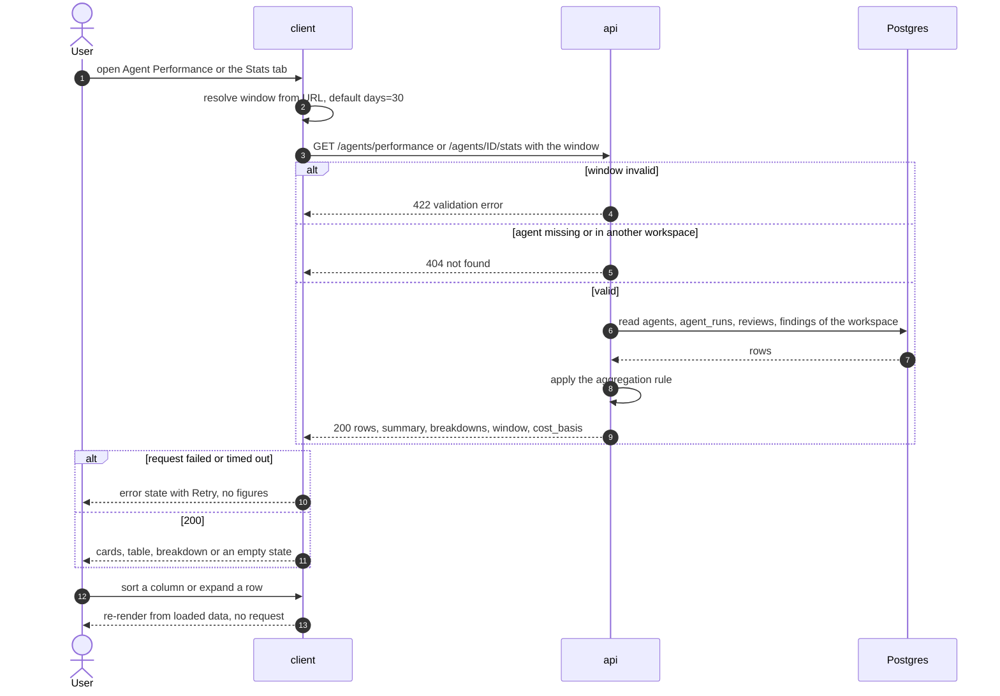
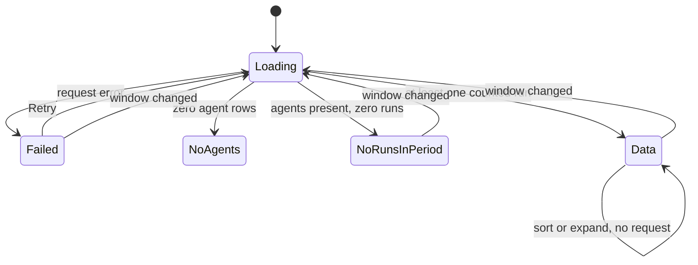

# Spec: Agent Performance — global dashboard and per-agent Stats tab over one stored-data aggregation rule
Spec ID: SPEC-10
Status: implemented
Supersedes: none
Provenance: final course homework. The user delegated every product decision to the session ("I won't intervene, do the work yourself") and pre-approved the spec; the caller relayed both on 2026-10-17. Each choice made under that delegation is recorded with its rationale in *Design review → Decisions (delegated)*.

## Problem and user

A **workspace owner** runs several review agents, locally from the PR page, as multi-agent
runs, and in CI (SPEC-09). Today they cannot answer "which agents earn their keep?" without
opening PRs one by one. The numbers exist in the database: every run is an `agent_runs` row with
cost, duration and status (`server/src/db/schema/runs.ts:19-56`), and every triage decision is
an `accepted_at` / `dismissed_at` on a finding (`server/src/db/schema/reviews.ts:54-55`). But no
screen rolls them up. The agent editor has no Stats tab yet
(`client/src/app/agents/[id]/_components/AgentEditor/constants.ts:10-17`: "Stats arrives with a
later lesson"), and `/agent-performance` is mapped in the shell (`client/src/components/app-shell/helpers.ts:41`)
with no page behind it.

The cost of the gap: an owner keeps paying for an agent whose findings are mostly dismissed, or
drops a good one on a gut feeling. Worse, a naive dashboard shows "0%" over zero decisions or
"$0.00" over unpriced runs, and those numbers are accusations the data never made
(`client/specs/L02-skills.md:187-188`).

## Goals / Non-goals

**Goals.**
- A global **Agent Performance** page at `/agent-performance`, in the sidebar GLOBAL section
  (mock N11 `agent-perf`, `docs/design/extracted/screen_agentperf.jsx:39-62`). It has four
  summary cards, a sortable per-agent table with expandable rows, and cost breakdowns by agent
  and by model.
- A per-agent **Stats** tab in the agent editor (mock `StatsTab`,
  `docs/design/extracted/screen_agents.jsx:79-85`), limited to the four headline metrics and the
  window selector.
- **One aggregation rule** serves both screens through two read-only endpoints that return the
  same per-agent row shape. Runs, cost, duration and accept rate for an agent therefore match
  between the two views **by construction**.
- Windows: **1 day**, **30 days** and a **custom range**, shared by both views and kept in the URL.
- Honest numbers: the accept-rate denominator and the sample size are always visible, and small
  samples are marked. Loading and error states never show invented zeros. Every cost is labelled
  a DevDigest estimate.
- Strictly read-only: only stored runs and findings are read; no model call and no review.

**Non-goals.**
- **Stats-tab panels without backing data or outside the headline:** "Most-used skills", "Most-pulled
  memory", "Findings by severity", "Findings by category" and "Run history"
  (`screen_agents.jsx:86-114`). Memory has no per-run attribution, and run history already lives
  on the PR page, the CI Runs page and the agent CI tab. Decision D-1.
- **Previous-period deltas:** the mock's "-$1.20" under Total cost
  (`screen_agentperf.jsx:51`, `data2.jsx:85` `costDelta`), the "-$0.01" under Avg cost/run
  (`screen_agents.jsx:83`), and the per-agent accept arrows (`screen_agentperf.jsx:31`,
  `data2.jsx:87-89` `acceptDelta`). The request does not ask for them, and a delta over two
  windows of different sample sizes misleads more than it informs. Decision D-13.
- **The Total-runs card sparkline** (`screen_agentperf.jsx:50`) and the Stats-tab runs sparkline
  (`screen_agents.jsx:82`): daily buckets need a day boundary in the user's timezone, which the
  server does not know. Decision D-13.
- **Colour-coding accept rates against a fixed threshold** (the mock's `>= 0.6` green/amber,
  `screen_agentperf.jsx:30`): a fixed bar is a judgement the data does not make. Decision D-13.
- **Reconciled billing data.** No provider billing import exists. All cost is a DevDigest estimate
  and is labelled so; a reconciliation feature is a later spec. Decision D-11.
- **Spend of deleted agents.** Deleting an agent sets `agent_runs.agent_id` to null
  (`runs.ts:24`), so those runs cannot be attributed and are excluded everywhere. Decision D-19.
- **Tightening the CI ingest cost bound.** `CiResultArtifact.cost_usd` accepts any number
  (`server/src/vendor/shared/contracts/eval-ci.ts:593`); SPEC-09 is approved and is not edited.
  This spec guards against it at read time (AC-3). Decision D-23.
- **Live updates, auto-refresh, pagination of the agent table, CSV export, per-repo filtering**
  and an MCP tool for these numbers.
- **Persisting sort order** across reloads. Decision D-17.

## User stories

- **US-1** As a workspace owner, I want one screen with total runs, total cost, the average accept rate and the most-active agent for a period I choose, so that I can see at a glance whether my agents earn their keep.
- **US-2** As a workspace owner, I want a per-agent table I can sort, with the accept-rate denominator and the run count beside every rate, so that I never rank agents on a sample too small to mean anything.
- **US-3** As a workspace owner, I want the period's cost broken down by agent and by model, with both breakdowns adding up to the total and clearly marked as estimates, so that I know where the money goes and how far to trust the figure.
- **US-4** As a workspace owner, I want to switch between 1 day, 30 days and a custom range, and keep my choice across a reload, so that I can look at the period I care about.
- **US-5** As an agent author, I want a Stats tab on the agent showing the same runs, cost, duration and accept rate the dashboard shows for that agent, so that the two screens never contradict each other.
- **US-6** As any user, I want loading, error and empty states that never show a zero the data did not produce, so that I can tell "nothing happened" from "we don't know yet".
- **US-7** As a workspace owner, I want viewing, reloading, sorting and expanding to start no review and no model call, so that looking at performance costs nothing.
- **US-8** As a workspace owner, I want to expand an agent's row to see its last few runs and jump to its Stats tab for the same period, so that I can drill into one agent without losing context.

## Acceptance criteria (EARS)

Terms used below. **Window**: the half-open time interval `[from, to)` resolved from the request
(AC-15). **Counted run**: a run that passes AC-1. **Decided finding**: a finding with
`accepted_at` or `dismissed_at` set. **MIN_DECISIONS**: 5 (Decision D-8).

### A. The aggregation rule (one rule, both endpoints)

**AC-1 [server]** The system shall count as a run of an agent for a window exactly the
`agent_runs` rows that belong to the caller's workspace, carry that `agent_id`, have
`status = 'done'`, and have `ran_at` inside the window. `source` (`local` or `ci`) and
membership in a multi-agent run do not matter.
Verify: integration — seed one agent with done/failed/cancelled/running local runs, done CI runs (succeeded and skipped), a done multi-agent child run and a done run one second outside the window; `runs` equals the number of done in-window rows (local + CI + multi-agent).

**AC-2 [server]** The system shall report, as `failed_runs`, the number of the agent's in-window
runs with `status` `failed` or `cancelled`. No other figure includes them.
Verify: integration — the seed from AC-1 yields `failed_runs` = failed + cancelled, and those rows change no cost, duration or finding figure.

**AC-3 [server]** IF a counted run's `cost_usd` is null, negative, non-finite or greater than
1000, THEN the system shall treat that run as unpriced in every cost figure, including the
`cost_usd` it reports for the run in `recent_runs`.
Verify: integration — counted CI runs with `cost_usd` −0.5 and 5000 contribute to `runs` but not to `priced_runs` or any cost sum, and appear with `cost_usd: null` in `recent_runs`.

**AC-4 [server]** The system shall report, as `priced_runs`, the number of the agent's counted
runs whose cost is valid under AC-3. A cost of exactly 0 counts as priced.
Verify: unit — rows with costs [0.04, null, 0, −1] give `priced_runs` = 2.

**AC-5 [server]** The system shall report the agent's `total_cost_usd` as the sum of the valid
costs of its counted runs, or null when `priced_runs` is 0.
Verify: unit — costs [0.04, 0.06, null] give 0.10; all-null gives null, not 0; [0] gives 0.

**AC-6 [server]** The system shall report the agent's `avg_cost_usd` as `total_cost_usd`
divided by `priced_runs`, or null when `priced_runs` is 0.
Verify: unit — costs [0.04, 0.06, null] give 0.05 (the unpriced run is not in the denominator).

**AC-7 [server]** The system shall report the agent's `avg_duration_ms` as the arithmetic mean
of `duration_ms` over its counted runs with a non-null duration, or null when there are none.
Verify: unit — durations [6000, 7000, null] give 6500; all-null gives null.

**AC-8 [server]** The system shall report, for the agent, `findings` (all findings of reviews
whose `run_id` is one of its counted runs), `accepted` (those with `accepted_at` set) and
`dismissed` (those with `dismissed_at` set), counted as in `skillStatsFrom`
(`server/src/modules/skills/stats.ts:49-51`).
Verify: integration — two counted runs with reviews holding 3 accepted, 2 dismissed and 4 untriaged findings, plus a finding on a failed run's review; result is `findings` 9, `accepted` 3, `dismissed` 2.

**AC-9 [server]** The system shall report the agent's `accept_rate` as
`accepted / (accepted + dismissed)`, or null when `accepted + dismissed` is 0. This is the
definition at `server/src/modules/skills/stats.ts:72`, and the response never carries 0 for "no
decisions".
Verify: unit — (3, 2) gives 0.6; (0, 0) gives null; (0, 4) gives 0.

**AC-10 [server]** The system shall set the agent's `small_sample` to true exactly when
`1 <= accepted + dismissed < MIN_DECISIONS` (5).
Verify: unit — 0 decided gives false, 1 and 4 give true, 5 gives false.

**AC-11 [server]** The system shall report the agent's `last_run_at` as the `ran_at` of its
newest run with `status = 'done'` at any time, regardless of the window, or null when it has
none.
Verify: integration — an agent whose only done run is 40 days old has `runs` 0 for a 30-day window and `last_run_at` equal to that run's time; a never-run agent has null.

**AC-12 [server]** The system shall report the agent's `recent_runs` as at most 5 of its counted
runs, newest `ran_at` first, each with `run_id`, `ran_at`, `source`, `duration_ms` and
`cost_usd`.
Verify: integration — an agent with 7 counted runs gets the 5 newest in descending order; one with 2 gets 2.

**AC-13 [server]** The system shall compute every figure from the database at request time,
without a server-side cache.
Verify: integration — dismiss one finding between two identical requests; the second response's `dismissed` is one higher.

**AC-14 [server]** For a given agent and window, the agent's row in `GET /agents/performance`
shall be field-for-field equal to `agent` in `GET /agents/:id/stats`.
Verify: integration — for every agent of a mixed seed (local, CI, multi-agent, unpriced, untriaged) and for an explicit `from`/`to` window, deep-equal the two objects.

### B. The window

**AC-15 [server]** Both endpoints shall resolve the window from exactly one of: `days` ∈ {1, 30},
giving `[now − days × 24 h, now)`; or `from` and `to`, ISO-8601 date-times with offset, giving
`[from, to)`. With no window parameter, the window is `days = 30`.
Verify: integration — `days=1` counts a run 23 h old and not one 25 h old; `from`/`to` counts a run at `from` and not one at `to`; no parameter behaves as `days=30`.

**AC-16 [server]** IF the window parameters are invalid — `days` outside {1, 30}, `days`
together with `from`/`to`, only one of `from`/`to`, an unparsable date-time, `from >= to`, or a
span longer than 366 days — THEN the system shall respond 422 with a validation error and
compute nothing.
Verify: integration — each of the six cases returns 422.

**AC-17 [server]** Both endpoints shall echo the resolved window as `window.from` and
`window.to` (ISO-8601 UTC) together with `window.days` (1, 30 or null for a custom range).
Verify: integration — a `days=30` request returns `to − from` = 30 × 24 h and `days: 30`; a custom request returns its own bounds and `days: null`.

### C. The dashboard endpoint

**AC-18 [server]** `GET /agents/performance` shall return one row per agent of the caller's
workspace, enabled or disabled, including agents with 0 counted runs in the window.
Verify: integration — a workspace with 3 agents, one disabled and one never run, returns 3 rows.

**AC-19 [server]** The system shall report `summary.runs`, `summary.failed_runs` and
`summary.priced_runs` as the sums of the same fields over all agent rows.
Verify: integration — the summary of a three-agent seed equals the hand-computed row sums.

**AC-20 [server]** The system shall report `summary.total_cost_usd` as the sum of the non-null
`total_cost_usd` of all rows, or null when every row's total is null.
Verify: unit — row totals [0.10, null, 0.05] give 0.15; [null, null] gives null.

**AC-21 [server]** The system shall return `cost_by_agent` with one segment per agent whose
`priced_runs` is at least 1, valued at that agent's `total_cost_usd`. The segment values sum to
`summary.total_cost_usd` within 1e-9.
Verify: unit — rollup over a mixed fixture: segment count equals agents with priced runs, and the sum matches the total to 1e-9.

**AC-22 [server]** The system shall return `cost_by_model` with one segment per distinct `model`
recorded on priced counted runs, plus one segment with `model: null` for priced counted runs
that recorded no model. The segment values sum to `summary.total_cost_usd` within 1e-9.
Verify: unit — fixture with two models plus CI runs with null model gives three segments summing to the total; integration — a CI run seeded as the CI ingest writes it (`server/src/modules/ci/repository.ts:301-311`, no model) lands in the null segment.

**AC-23 [server]** The system shall report the summary accept rate as
`summary.accepted / (summary.accepted + summary.dismissed)` pooled over all rows (not the mean
of per-agent rates), together with `summary.accepted`, `summary.dismissed` and
`summary.small_sample` under the AC-9 and AC-10 rules.
Verify: unit — rows (9 of 10) and (0 of 1) give 9/11 ≈ 0.818, not the 0.45 mean.

**AC-24 [server]** The system shall report `summary.most_active` as the agent with the most
counted runs. Ties go to the newer newest in-window run, then to the lower agent name (case-insensitive),
then to the lower `agent_id`. The value is null when `summary.runs` is 0.
Verify: unit — tie on runs resolved by newest run, then by name; all-zero gives null.

**AC-25 [server]** Both endpoints shall return `cost_basis: "estimate"`.
Verify: integration — the field is present with that value on both responses.

**AC-26 [server]** Both endpoints shall read only agents, runs, reviews and findings of the
caller's workspace. Findings are reached only through reviews already filtered by that workspace
(`server/INSIGHTS.md` 2026-09-16 findings-tenancy entry).
Verify: integration — two workspaces with runs and decided findings; each sees only its own agents, runs, cost and decisions, and a review in workspace B whose `run_id` equals a run id of A adds nothing to A.

**AC-27 [server]** IF `GET /agents/:id/stats` names an agent id that does not exist or belongs to
another workspace, THEN the system shall respond 404 with the same body in both cases.
Verify: integration — unknown uuid and other-workspace agent both return an identical 404 body.

**AC-28 [server]** Neither endpoint shall invoke an LLM provider, enqueue a job or review, or
write to the database.
Verify: integration — with the LLM provider and job runner replaced by spies, both endpoints (any window) leave the spies uncalled and the `agent_runs`, `reviews`, `findings` row counts and `max(ran_at)` unchanged.

### D. The dashboard page

**AC-29 [client]** The sidebar GLOBAL section shall show an "Agent Performance" item linking to
`/agent-performance`, highlighted while that route is open.
Verify: unit — the shell renders the item under GLOBAL with that href, and it is active for `/agent-performance`.

**AC-30 [client]** The page shall show the title "Agent Performance" and a window selector
offering "1 day", "30 days" and "Custom range", with "30 days" selected when the URL carries no
window.
Verify: unit — rendering `/agent-performance` shows the three options with "30 days" selected and requests `days=30`.

**AC-31 [client]** WHEN the user selects a window, the page shall write it to the URL query
(`days=1`, `days=30`, or `from=YYYY-MM-DD&to=YYYY-MM-DD` as calendar dates), so a reload
restores the same window.
Verify: e2e — choose a custom range, reload, and the same range is selected and requested.

**AC-32 [client]** IF the URL window parameters are missing a part, malformed or fail the AC-34
rules, THEN the page shall replace them with `days=30` and load that window.
Verify: unit — `?from=2026-13-01` and `?days=7` both end on `days=30` without an error state.

**AC-33 [client]** WHEN the user applies a custom range of start date S and end date E, the page
shall request `from` = local midnight starting S and `to` = local midnight starting the day after
E, both with the browser's UTC offset.
Verify: unit — with the timezone fixed to Europe/Kyiv, 2026-10-01..2026-10-07 requests `from=2026-10-01T00:00:00+03:00` and `to=2026-10-08T00:00:00+03:00`.

**AC-34 [client]** IF a custom range has an empty date, a start after its end, an end after
today, or a span longer than 366 days, THEN the page shall disable "Apply" and show the reason
inline, sending no request.
Verify: unit — each of the four cases disables Apply, shows its message, and fetch is not called.

**AC-35 [client]** The "Total runs" card shall show `summary.runs` and, when
`summary.failed_runs` is above 0, the line "N failed or cancelled, not counted".
Verify: unit — fixture with runs 42 and failed 3 shows "42" and the excluded line; with failed 0 the line is absent.

**AC-36 [client]** The "Total cost" card shall show `summary.total_cost_usd` through `formatCost`
(`client/src/lib/cost.ts:13`) and, when `summary.runs − summary.priced_runs` is above 0, the line
"N of M runs unpriced".
Verify: unit — total null shows "—"; 0 shows "$0.00"; 8.74 with 2 unpriced of 40 shows "$8.74" and "2 of 40 runs unpriced".

**AC-37 [client]** The "Avg accept rate" card shall show the pooled rate as a whole percent with
"accepted of decided" beneath it (e.g. "61% · 55 of 90 decided"). When the rate is null it shows
"—" with "0 decided".
Verify: unit — fixtures for 55/90 and for 0 decided render those strings; no "0%" appears for 0 decided.

**AC-38 [client]** The "Most-active agent" card shall show `summary.most_active`'s name and its
run count in the window.
Verify: unit — fixture renders "Security Reviewer" and "142 runs".

**AC-39 [client]** The agent table shall show the columns Agent, Runs, Avg cost, Avg duration,
Accept rate, Last run and View, with one row per agent in the response.
Verify: unit — a 3-row fixture renders 7 column headers and 3 rows.

**AC-40 [client]** Each Accept-rate cell shall show the whole-percent rate beside its denominator
as "accepted/decided" (e.g. "78% · 18/23"), or "—" with "0 decided" when the rate is null.
Verify: unit — rows with 18/23 and with 0 decided render those texts.

**AC-41 [client]** WHERE a row's `small_sample` is true, the Accept-rate cell shall carry the text
mark "small sample (n = D)", where D is its decided count.
Verify: unit — a row with 3 decided shows "small sample (n = 3)"; a row with 5 shows no mark.

**AC-42 [client]** On load, the table shall be ordered by accept rate descending in three tiers:
rows with at least MIN_DECISIONS decisions first, then small-sample rows, then rows with no
decisions. Within a tier rows go by rate, then by runs descending, then by name.
Verify: unit — fixture with a 100% small-sample row and a 70% ranked row lists the 70% row first and the no-decision row last.

**AC-43 [client]** WHEN the user activates a sortable column header (Agent, Runs, Avg cost, Avg
duration, Accept rate, Last run), the table shall re-order its rows client-side without any
network request. A second activation reverses the direction, null values stay last in both
directions, and the AC-42 tiers stay in place for Accept rate.
Verify: unit — with fetch spied, sort each column both ways; order matches expectation and fetch call count is unchanged.

**AC-44 [client]** WHEN the user activates a row's expand control, the row shall show its
`recent_runs` (each run's time, source, duration and cost, plus a duration sparkline) from the
already-loaded response, with at most one row expanded at a time and no network request.
Verify: unit — expand row A then row B; only B is open, its runs are listed newest first, and fetch call count is unchanged.

**AC-45 [client]** WHEN an agent has 0 counted runs in the window, its row shall show Runs "0",
"—" for Avg cost, Avg duration and Accept rate, and Last run as the relative time of
`last_run_at` or "Never". Its expanded area reads "No runs in this period".
Verify: unit — a zero-run row with `last_run_at` 40 days ago and one with null render those texts.

**AC-46 [client]** Each row's "View" link shall open `/agents/<id>?tab=stats` carrying the
dashboard's current window parameters.
Verify: unit — with `?days=1` the View href is `/agents/<id>?tab=stats&days=1`; with a custom range it carries the same `from`/`to`.

**AC-47 [client]** The "Cost breakdown" section shall show a "By agent" and a "By model" donut,
each with a legend giving every segment's name and `formatCost` amount. A `model: null` segment
is labelled "Model not recorded".
Verify: unit — fixture with 3 agent and 3 model segments (one null) renders both legends with those labels and amounts.

**AC-48 [client]** IF `summary.total_cost_usd` is null while `summary.runs` is above 0, THEN both
breakdown panels shall show "No priced runs in this period" instead of a donut.
Verify: unit — fixture with runs 5 and total null shows the message twice and no donut.

**AC-49 [client]** The Total cost card, the Avg cost column header and the Cost breakdown section
shall each carry the label "DevDigest estimate" whose explanation reads that cost is computed by
DevDigest at run time (from token counts and its price table, or the per-request cost OpenRouter
reports) and is not reconciled with provider billing. The label is driven by `cost_basis`.
Verify: unit — the three places show the label, and the explanation text is reachable by hover and keyboard focus.

**AC-50 [client]** WHILE the dashboard request is pending, the page shall show placeholders in
the cards, table and breakdown, and no digit, "0", "$0.00" or "—" value.
Verify: unit — with the request held pending, no card or cell contains a digit, "$" or "—".

**AC-51 [client]** IF the dashboard request fails, THEN the page shall show an error message with a
"Retry" action in place of cards, table and breakdown, and keep the window selector usable.
Verify: unit — a 500 response renders the error and Retry, no figure, and an enabled window selector; Retry re-requests.

**AC-52 [client]** WHEN the response has at least one agent and `summary.runs` is 0, the page
shall show the empty state "No agent runs in this period" with the window's dates and a hint to
pick a wider range, in place of cards, table and breakdown.
Verify: unit — fixture with 2 zero-run agents shows the empty state and no table.

**AC-53 [client]** WHEN the response has no agent rows, the page shall show the empty state "No
agents yet" with a link to `/agents`, in place of cards, table and breakdown.
Verify: unit — empty `agents` renders that state and link, distinct from AC-52's.

**AC-54 [client]** WHEN the user changes the window while an earlier dashboard request is still
pending, the page shall render only the response for the latest window.
Verify: unit — resolve the `days=30` response after the `days=1` one; the page shows the `days=1` figures.

**AC-55 [client]** The page shall truncate an agent name longer than its cell with an ellipsis,
and expose the full name as the element's accessible name and tooltip.
Verify: unit — a 120-character name renders truncated styling and its full text as the title and accessible name.

**AC-56 [client]** Both views shall format durations as seconds with one decimal ("6.2s"),
counts with the `en` locale, cost with `formatCost`, accept rates as whole percents, and Last run
as a relative time with the absolute time in a tooltip.
Verify: unit — `avg_duration_ms` 6234 shows "6.2s"; 1234 runs shows "1,234" whatever the machine locale (`client/INSIGHTS.md` 2026-09-16 toLocaleString entry).

### E. The agent Stats tab

**AC-57 [client]** The agent editor shall show a "Stats" tab between "Evals" and "CI", reachable
as `?tab=stats`.
Verify: unit — tab order is Config, Skills, Context, Evals, Stats, CI, and `?tab=stats` opens Stats.

**AC-58 [client]** The Stats tab shall offer the same window selector, default, URL parameters,
custom-range conversion and validation as the dashboard (AC-30 to AC-34).
Verify: unit — the shared behaviours from AC-30 to AC-34 hold on `/agents/<id>?tab=stats`, which requests `GET /agents/<id>/stats` with the same parameters.

**AC-59 [client, server]** The Stats tab shall show four cards (Total runs, Avg cost / run, Avg
duration, Accept rate) filled from the `agent` row of `GET /agents/:id/stats`.
Verify: unit — fixture row renders the four values; integration — the endpoint returns the row described in section A.

**AC-60 [client]** The Stats-tab Accept-rate card shall show the denominator "accepted of
decided" and, WHERE `small_sample` is true, the mark "small sample (n = D)".
Verify: unit — rows with 3 of 4 decided and with 0 decided render "75% · 3 of 4 decided · small sample (n = 4)" and "— · 0 decided".

**AC-61 [client]** The Stats-tab Avg cost card shall carry the "DevDigest estimate" label from
AC-49 and, when `priced_runs` is below `runs`, the line "P of N runs priced".
Verify: unit — row with runs 10 and priced 8 shows "8 of 10 runs priced" and the label.

**AC-62 [client]** For the same agent and window, the Stats tab shall display the same strings for
runs, avg cost, avg duration and accept rate (with its denominator) as that agent's dashboard
row.
Verify: e2e — seed runs and decisions, open the dashboard with a custom range, follow an agent's View link, and compare the four displayed values; unit — one row fixture rendered by both views gives identical strings.

**AC-63 [client]** WHILE the Stats request is pending, the tab shall show placeholders and no
digit, "0", "$0.00" or "—" value.
Verify: unit — with the request held pending, no card contains a digit, "$" or "—".

**AC-64 [client]** IF the Stats request fails, THEN the tab shall show an error message with a
"Retry" action and no figures.
Verify: unit — a 500 response renders the error and Retry; Retry re-requests.

**AC-65 [client]** WHEN the agent has 0 counted runs in the window, the tab shall show "This agent
has not run yet" if `last_run_at` is null, or "No runs in this period · last run <relative time>"
otherwise, in place of the four cards.
Verify: unit — rows with null and with a 40-day-old `last_run_at` render the two distinct texts.

## Edge cases

- **EC-1** An agent has runs only outside the window → its row stays, with 0 runs and its last run time. → AC-18, AC-45
- **EC-2** An agent has never run → row with "Never"; Stats tab "This agent has not run yet". → AC-45, AC-65
- **EC-3** The workspace has no agents at all → "No agents yet". → AC-53
- **EC-4** Agents exist but no counted run falls in the window → "No agent runs in this period". → AC-52
- **EC-5** Every counted run is unpriced → Total cost "—", breakdowns "No priced runs in this period". → AC-5, AC-20, AC-36, AC-48
- **EC-6** Some counted runs are unpriced → averages exclude them; "N of M runs unpriced". → AC-6, AC-36, AC-61
- **EC-7** A free model reports cost 0 → priced, shown "$0.00", never "—". → AC-4, AC-36
- **EC-8** CI runs record no model (`server/src/modules/ci/repository.ts:301-311`) → "Model not recorded" segment. → AC-22, AC-47
- **EC-9** A CI run is `skipped` (stored as `done`, no cost or duration, `server/src/modules/ci/helpers/ingest.ts:90,113-115`) → counts as a run, adds to no average. → AC-1, AC-6, AC-7
- **EC-10** Failed and cancelled runs → excluded from every figure and reported as `failed_runs`. → AC-1, AC-2, AC-35
- **EC-11** A run still `running` (or a CI run with null status, `ingest.ts:111-114`) → ignored entirely. → AC-1
- **EC-12** Runs of a deleted agent (`agent_id` null) → excluded. → Non-goal (spend of deleted agents)
- **EC-13** An agent's findings are all untriaged → accept rate "—", "0 decided", sorted last. → AC-9, AC-40, AC-42
- **EC-14** An agent has 1 to 4 decisions → "small sample (n = D)", ranked after agents with 5 or more. → AC-10, AC-41, AC-42
- **EC-15** Two agents tie for most runs → deterministic tie-break. → AC-24
- **EC-16** A finding is triaged after the page loaded → visible on the next load or window change. → AC-13
- **EC-17** A custom range is invalid (reversed, empty, future end, over 366 days) → Apply disabled; the server rejects a forged one. → AC-34, AC-16
- **EC-18** The URL carries malformed window parameters → falls back to 30 days. → AC-32
- **EC-19** The Stats URL names another workspace's agent → 404, same as unknown. → AC-27
- **EC-20** The PR of a run was deleted: its reviews and findings cascade away (`reviews.ts:14-16,40-42`) while the run keeps `pr_id` null (`runs.ts:25`) → the run still counts, but its decisions are gone. → AC-1, AC-8
- **EC-21** A multi-agent run → each child run counts under its own agent. → AC-1
- **EC-22** A CI artifact reports a negative or absurd cost (the artifact schema does not bound it, `eval-ci.ts:593`) → treated as unpriced. → AC-3
- **EC-23** A custom range crosses a DST change → bounds are local midnights with their own offsets. → AC-33
- **EC-24** The user switches windows quickly → only the latest response renders. → AC-54
- **EC-25** A disabled agent → still listed with its history. → AC-18
- **EC-26** A very long agent name → truncated, full name in tooltip. → AC-55
- **EC-27** CI runs have finding counts but no finding rows in DevDigest (CI ingest writes only `agent_runs` and `ci_runs`, `server/src/modules/ci/repository.ts:269-316`) → they add runs and cost but nothing to the accept-rate denominator, which the visible denominator makes plain. → AC-8, AC-40

## Non-functional requirements

**NFR-1 [server]** WHEN a workspace holds 50 agents, 10,000 counted runs and 30,000 findings in
a 30-day window, `GET /agents/performance` shall respond within 2 s.
Verify: integration — timed request against that seed on the CI Postgres; assert under 2000 ms.

**NFR-2 [server]** WHEN the same seed is in place, `GET /agents/:id/stats` for the busiest agent
shall respond within 1 s.
Verify: integration — timed request; assert under 1000 ms.

**NFR-3 [client]** Every interactive element added by this feature (window options, date
inputs, Apply, sortable headers, row expand controls, View links, Retry, the estimate
explanation) shall be reachable with Tab and operable with Enter or Space. Sortable headers
expose `aria-sort` and expand controls expose `aria-expanded`.
Verify: unit — role/attribute queries find each control with the stated attributes, and keyboard events operate them; manual — visible focus ring checked once in the browser (focus styling is not observable in jsdom).

**NFR-4 [client]** All text and marks added by this feature, including "small sample" and
"DevDigest estimate", shall meet WCAG 2.2 AA contrast (4.5:1 for normal text) in the light and
dark themes.
Verify: manual — contrast measured with browser devtools on both themes (jsdom computes no colours).

**NFR-5 [client]** Every new UI string shall come from the `agentPerformance` namespace
(dashboard) or the `agents` namespace (Stats tab) under `client/messages/en/`.
Verify: unit — rendering each state (loading, error, both empty states, data, small sample, unpriced) shows no raw `agentPerformance.` or `agents.` key.

## Module interactions

Boundaries crossed: client ↔ API (two new GET reads) and API ↔ Postgres. No call reaches
reviewer-core, an LLM provider, GitHub or MCP (AC-28).

### Service communication

Failure behaviour per arrow:
- client → api fails (network, 5xx) → AC-51, AC-64.
- api rejects the window → 422, AC-16; the client never sends an invalid custom range (AC-34) and
  repairs a bad URL (AC-32).
- api → Postgres fails → the API's standard 5xx, surfaced by AC-51 / AC-64.
- A slow response → placeholders without figures (AC-50, AC-63); a superseded response is
  dropped (AC-54).

### Page states

### Contracts

Both are **changed** existing contracts. Each is defined today in `@devdigest/shared` with no
route and no consumer behind it: `AgentPerf` / `AgentPerfRow` for `GET /agents/performance`
(`server/src/vendor/shared/contracts/productionize.ts:134-186`), and `AgentStats` for
`GET /agents/:id/stats` (`server/src/vendor/shared/contracts/observability.ts:137-168`). Their
current shapes have two different row types, no window echo, no cost basis, no sample-size flag
and no priced-run count, so they cannot guarantee parity. The fields below are the contract.
Scaffold fields not listed here (`dismiss_rate`, `avg_findings_per_run`,
`findings_by_severity`, `trend`, `pending`) are not part of it.

**Window query (both endpoints) — proposed**

| Param | Type | Required | Notes |
|---|---|---|---|
| `days` | int, 1 or 30 | optional | exclusive with `from`/`to`; default 30 when nothing is sent |
| `from` | ISO-8601 date-time with offset | with `to` | inclusive lower bound |
| `to` | ISO-8601 date-time with offset | with `from` | exclusive upper bound; `to − from` ≤ 366 days |

Errors: `422` for any AC-16 case.

**Per-agent row (shared by both responses) — proposed**

| Field | Type | Required | Meaning |
|---|---|---|---|
| `agent_id` | string | req | |
| `agent_name` | string | req | current name |
| `enabled` | boolean | req | |
| `runs` | int | req | counted runs (AC-1) |
| `failed_runs` | int | req | AC-2 |
| `priced_runs` | int | req | AC-4 |
| `total_cost_usd` | number \| null | req | AC-5 |
| `avg_cost_usd` | number \| null | req | AC-6 |
| `avg_duration_ms` | number \| null | req | AC-7 |
| `findings` | int | req | AC-8 |
| `accepted` | int | req | AC-8 |
| `dismissed` | int | req | AC-8 |
| `accept_rate` | number 0..1 \| null | req | AC-9; null means no decisions |
| `small_sample` | boolean | req | AC-10 |
| `last_run_at` | ISO string \| null | req | AC-11, window-independent |
| `recent_runs` | array (≤ 5) of `{run_id: string, ran_at: string, source: 'local' \| 'ci', duration_ms: int \| null, cost_usd: number \| null}` | req | AC-12; cost after AC-3 |

**`GET /agents/performance` → 200 — proposed (changes `AgentPerf`)**

| Field | Type | Required |
|---|---|---|
| `window` | `{from: string, to: string, days: 1 \| 30 \| null}` | req |
| `cost_basis` | `"estimate"` | req |
| `min_decisions` | int (5) | req |
| `summary` | `{runs: int, failed_runs: int, priced_runs: int, total_cost_usd: number \| null, accepted: int, dismissed: int, accept_rate: number \| null, small_sample: boolean, most_active: {agent_id: string, agent_name: string, runs: int} \| null}` | req |
| `agents` | array of per-agent row | req |
| `cost_by_agent` | array of `{agent_id: string, agent_name: string, cost_usd: number}` | req |
| `cost_by_model` | array of `{model: string \| null, cost_usd: number, runs: int}` (`runs` = priced runs in the segment) | req |

Errors: `422` (window).

**`GET /agents/:id/stats` → 200 — proposed (changes `AgentStats`)**

| Field | Type | Required |
|---|---|---|
| `window` | as above | req |
| `cost_basis` | `"estimate"` | req |
| `min_decisions` | int (5) | req |
| `agent` | per-agent row | req |

Errors: `404` (unknown or other-workspace agent, one body), `422` (window).

## Inputs and provenance

| Input | Comes from | Produced by | Freshness | Trusted |
|---|---|---|---|---|
| Window (`days` / `from` / `to`) | URL query, user picks | user | per request | no — validated (AC-16, AC-32, AC-34) |
| Agent id (Stats route) | URL path | user / link | per request | no — workspace-scoped (AC-27) |
| Agent name, enabled flag | `agents` | user in the studio, or a plugin import (`productionize.ts:123-131`) | read at request time | no — rendered as text (AC-55) |
| Run status, `ran_at`, `source`, `agent_id` | `agent_runs` | local review executor (`server/src/modules/reviews/repository/run.repo.ts:179-229`); CI ingest (`server/src/modules/ci/repository.ts:269-316`) | at request time (AC-13) | local: yes; CI: identity cross-checked at ingest (SPEC-09) |
| `cost_usd` (local) | `agent_runs` | price-table estimate (`server/src/adapters/llm/pricing.ts:37`) or OpenRouter `usage.cost` (`reviewer-core/src/llm/openrouter.ts:99-110`) | at request time | yes, but an estimate (AC-49) |
| `cost_usd`, `duration_ms` (CI) | `agent_runs` ← `devdigest-result.json` | CI runner; the PR author can influence the workflow (`ingest.ts:4-5`) | as of the last CI Refresh | no — cost bounded at read (AC-3); duration bounded at ingest (`eval-ci.ts:594`) |
| `model` | `agent_runs` | local executor at run start; null for CI rows | at request time | yes (shown as text) |
| `accepted_at`, `dismissed_at` | `findings` via `reviews.run_id` | user triage in the studio | at request time | yes; tenancy via reviews (AC-26) |
| `cost_basis` | constant in the response | api | static | yes |

Eval runs never write `agent_runs` (only the reviews, multi-agent and CI modules insert into it),
so eval cost is not in these figures by construction.

## Untrusted inputs

- **Window parameters** are validated at the API boundary against the AC-16 rules and rejected
  with 422. The client pre-validates (AC-34) and repairs malformed URL values (AC-32). → AC-16,
  AC-32, AC-34
- **Agent id** is resolved only inside the caller's workspace. A foreign id is indistinguishable
  from an unknown one. → AC-27, AC-26
- **Agent names** (possibly from imported plugins) and **model strings** are rendered as plain
  text, never as HTML or markdown. Overlong names are truncated with the full text as the
  accessible name. → AC-55
- **CI-reported cost** is not bounded at ingest. At read time, a negative, non-finite or
  over-$1000 value is treated as unpriced, so one forged artifact cannot zero out or swamp the
  totals. → AC-3. Recorded risk: a forged artifact can still inflate cost within $0–$1000 per run.
  The expanded row shows each run's `source`, so CI-originated figures are distinguishable
  (AC-44).
- **Findings** are reached only through workspace-filtered reviews, never by run id alone. → AC-26
- No content is passed to a model. The feature has no prompt and no LLM output. → AC-28

## Design review

Evidence: mock N11 (`docs/design/extracted/screen_agentperf.jsx`, data `data2.jsx:84-101`);
mock Stats tab (`screen_agents.jsx:79-115`, artboard `agent-stats`, `INDEX.md:39`); the user's
screenshot, described by the caller as matching N11 (not passed by path); and the shipped code
cited inline.

### Findings and decisions

| # | Finding | Evidence | Decision → destination |
|---|---|---|---|
| DR-1 | The per-agent Stats tab does not exist, so "match the Stats tab" has nothing to match | `AgentEditor/constants.ts:10-17` | accepted: build the Stats tab headline → AC-57 to AC-65 (D-1) |
| DR-2 | Two unbacked contracts with different row shapes already exist | `productionize.ts:139-186`, `observability.ts:145-168` | accepted: one shared row, both contracts changed → AC-14, Contracts (D-2, D-22) |
| DR-3 | An orphan `agentPerformance` i18n namespace exists with a different column set | `client/messages/en/agentPerformance.json:1-32` | accepted: reuse the namespace → NFR-5 |
| DR-4 | The shell already maps `/agent-performance`; NAV has no item | `app-shell/helpers.ts:41`, `vendor/ui/nav.ts:67-71`, `client/INSIGHTS.md` 2026-09-19 | accepted → AC-29 |
| DR-5 | The mock shows only a "30 days" button; no 1-day or custom range drawn | `screen_agentperf.jsx:48` | accepted: three-option selector → AC-30 to AC-34 (D-9) |
| DR-6 | "Runs" undefined: failed, cancelled, running, CI skipped | `runs.ts:35-38`, `ingest.ts:86-115` | accepted: status `done` only, failed counted aside → AC-1, AC-2 (D-3, D-4) |
| DR-7 | Averages over runs with missing cost or duration | `runs.ts:32-34`, `ingest.ts:90` | accepted: average over runs having the value → AC-6, AC-7 (D-5) |
| DR-8 | CI artifact cost has no bounds | `eval-ci.ts:593` vs `eval-ci.ts:123` | accepted: validity rule at read → AC-3 (D-6) |
| DR-9 | Accept rate over zero decisions would read 0% | `skills/stats.ts:69-72`, `L02-skills.md:187-188` | accepted: null → "—" → AC-9, AC-37, AC-40 (D-7) |
| DR-10 | No sample-size signal in the mock | `screen_agentperf.jsx:29-31` | accepted: denominator everywhere plus small-sample tiering → AC-10, AC-40 to AC-42 (D-8) |
| DR-11 | Average accept rate definition ambiguous (pooled vs mean) | `screen_agentperf.jsx:52` | accepted: pooled → AC-23 (D-7) |
| DR-12 | Most-active ties undefined | `screen_agentperf.jsx:53` | accepted → AC-24 (D-10) |
| DR-13 | Estimate vs billed cost: nothing records which; no billing data exists | `pricing.ts:37`, `openrouter.ts:99-110` | accepted: everything labelled estimate, `cost_basis` on wire → AC-25, AC-49 (D-11) |
| DR-14 | CI runs record no model | `ci/repository.ts:301-311` | accepted: "Model not recorded" segment → AC-22, AC-47 (D-12) |
| DR-15 | Previous-period deltas and accept arrows | `screen_agentperf.jsx:31,51`, `screen_agents.jsx:83` | declined → Non-goal (D-13) |
| DR-16 | Summary and Stats sparklines need timezone day buckets | `screen_agentperf.jsx:50`, `screen_agents.jsx:82` | declined → Non-goal (D-13) |
| DR-17 | Fixed-threshold colour on accept rate | `screen_agentperf.jsx:30` | declined → Non-goal (D-13) |
| DR-18 | Expanded row shows "last 5 runs" with no data source | `screen_agentperf.jsx:34-36` | accepted: `recent_runs` in payload, no request → AC-12, AC-44 (D-15) |
| DR-19 | "Last run" for an agent without runs in the window | `screen_agentperf.jsx:32` | accepted: window-independent last run → AC-11, AC-45 (D-16) |
| DR-20 | Undrawn states: loading, error, no agents, no runs, zero-run agent, never-run agent | `screen_agentperf.jsx` (none drawn), `screen_agents.jsx:79-115` (none drawn) | accepted → AC-45, AC-50 to AC-53, AC-63 to AC-65 (D-14) |
| DR-21 | Stats panels without backing data | `screen_agents.jsx:86-114` | declined → Non-goal (D-1) |
| DR-22 | Tab order: mock Config/Skills/Evals/Stats/CI; shipped adds Context | `INDEX.md:121`, `constants.ts:11-17`, SPEC-04 DR-10 | accepted: Stats after Evals → AC-57 |
| DR-23 | "View" target and whether it keeps the window | `screen_agentperf.jsx:33` | accepted → AC-46 |
| DR-24 | Sorting, expanding and reloading must not call a model | request | accepted: client-side sort and expand, read-only endpoints → AC-28, AC-43, AC-44 |
| DR-25 | Deleted agents leave unattributable runs | `runs.ts:24` | declined: excluded → Non-goal (D-19) |
| DR-26 | Mock vs shipped UI: the page is not built; mock and screenshot agree | caller's description; no shipped route under `client/src/app/agent-performance` | not built yet — built per this spec |
| DR-27 | Machine-locale number formatting | `client/INSIGHTS.md` 2026-09-16 | accepted → AC-56 |
| DR-28 | Em-dash is the app-wide empty marker, which collides in tests | `client/INSIGHTS.md` 2026-09-16 em-dash entry | recorded for the planner; no AC (test-fixture concern) |

### Decisions (delegated)

Made by the session under the user's explicit delegation (see *Provenance*). Each is binding for
this spec; changing one is a new spec.

- **D-1 Stats-tab scope.** The tab carries the four headline cards and the window selector only.
  Rationale: the headline is what must match the dashboard. Skills already have their own Stats tab;
  memory has no per-run attribution; run history exists on three other screens.
- **D-2 One rule, one row.** Both endpoints return the same per-agent row computed by the same
  rule. Rationale: "numbers match" holds by construction rather than by two code paths agreeing.
- **D-3 Counted run = `status = 'done'`**, any source, multi-agent children included. Failed and
  cancelled runs are reported as `failed_runs` but excluded from all metrics; running runs are
  ignored; runs with no agent are excluded. Rationale: this matches the PR-list cost rule
  (`server/src/modules/pulls/cost.ts:4-7,23-30`; `server/INSIGHTS.md` 2026-09-16 running-total
  entry), so "Total cost" means the same thing on every screen.
- **D-4 CI runs count.** CI `succeeded` and `skipped` runs are `done` and count as runs. Skipped
  runs add no cost or duration. CI runs add no decisions, because their findings are not stored
  as finding rows. Rationale: CI runs are real agent activity, and leaving them out would
  understate the busiest agents. The visible denominator keeps the accept rate honest.
- **D-5 Averages over the runs that have the value**, with `priced_runs` exposed. Rationale: the
  same "unknown is not zero" rule as `skillStatsFrom` tokens (`skills/stats.ts:53-56`).
- **D-6 Cost validity: finite, 0 ≤ cost ≤ 1000 USD per run.** Anything else is unpriced.
  Rationale: this mirrors the bound the eval contract already uses (`eval-ci.ts:123`) and
  neutralises a forged CI artifact without editing approved SPEC-09.
- **D-7 Accept rate = `skillStatsFrom`'s definition**, null over zero decisions. Decisions are
  attributed to the run's `ran_at`, not to when the user triaged. The summary rate is pooled.
  Rationale: one definition across the product; pooling weights each decision equally, so one
  agent with 2 decisions cannot swing the headline.
- **D-8 Small sample = 1 to 4 decisions (MIN_DECISIONS = 5).** These rows are ranked after rows
  with ≥ 5 decisions and carry a text mark with n. Rationale: the smallest round threshold that
  stops a 1-of-1 "100%" from topping the table; the threshold travels in the response
  (`min_decisions`), so the UI never hard-codes it apart from the server.
- **D-9 Windows.** "1 day" = rolling 24 h; "30 days" = rolling 30 × 24 h. A custom range is a
  pair of calendar dates in the browser's timezone, sent as `[local midnight of start, local
  midnight after end)` with offsets. Both ends are inclusive in the UI, the max span is 366 days,
  and the end date is no later than today. The default is 30 days, and the choice is kept in the
  URL. Rationale: the server has no user timezone, so the client sends instants. Rolling presets
  need no timezone at all.
- **D-10 Most-active tie-break**: newer newest in-window run, then name, then id. Rationale:
  deterministic, and it favours the agent in current use.
- **D-11 Cost labelling.** Every cost is a "DevDigest estimate". The response carries
  `cost_basis: "estimate"`, and no per-run cost-source column is added. Rationale: no reconciled
  billing data exists anywhere, and OpenRouter's per-request `usage.cost` is still not reconciled
  billing. A column would only split "estimate" into two flavours of estimate. The wire field
  leaves room for a future `"reconciled"`.
- **D-12 Model breakdown** groups by the model string recorded on the run. Runs without one
  (all CI runs today) form a "Model not recorded" segment. Rationale: back-filling from the
  agent's current model would relabel history.
- **D-13 Dropped mock elements**: previous-period deltas, accept arrows, sparklines on summary
  cards, and threshold colours. Rationale: not requested, and each one either needs data
  semantics we do not have (timezone buckets) or implies a judgement the data does not make.
- **D-14 Four distinct empty states**: no agents, no runs in period (dashboard), agent with no runs
  in period, agent never run. Rationale: the course requires an agent with no runs and an empty
  dashboard to be different states.
- **D-15 Expanded row** shows up to 5 newest counted runs in the window from the same payload.
  Rationale: expanding must not trigger any request.
- **D-16 Last run is window-independent.** Rationale: it is what separates "idle this period" from
  "never used".
- **D-17 Sorting** is client-side and not persisted; the default is accept rate descending, as
  drawn ("Accept ↓", `screen_agentperf.jsx:56`).
- **D-18 No pagination.** Every agent of the workspace is listed. Rationale: workspaces hold
  tens of agents, and NFR-1 bounds the cost at 50.
- **D-19 Deleted agents' runs are excluded.** Rationale: they cannot be attributed, and including
  them only in the total would break the by-agent reconciliation.
- **D-20 Freshness**: figures are computed per request with no cache and no auto-refresh.
- **D-21 Read-only**: no write, no job, no model call (AC-28).
- **D-22 Paths**: page `/agent-performance` (already mapped in the shell); endpoints
  `GET /agents/performance` and `GET /agents/:id/stats` (the paths the scaffold contracts
  already name).
- **D-23 CI ingest untouched**: the missing cost bound is handled at read time (D-6), not by
  editing SPEC-09.

## Traceability

| AC / NFR | From (US / EC / design review) | Packages | Verify |
|---|---|---|---|
| AC-1 | US-1, EC-9, EC-10, EC-11, EC-20, EC-21, DR-6 | server | integration |
| AC-2 | US-1, EC-10, DR-6 | server | integration |
| AC-3 | US-3, EC-22, DR-8 | server | integration |
| AC-4 | US-3, EC-7, DR-7 | server | unit |
| AC-5 | US-3, EC-5, DR-7 | server | unit |
| AC-6 | US-3, EC-6, EC-9, DR-7 | server | unit |
| AC-7 | US-1, EC-9, DR-7 | server | unit |
| AC-8 | US-2, EC-20, EC-27, DR-9 | server | integration |
| AC-9 | US-2, EC-13, DR-9 | server | unit |
| AC-10 | US-2, EC-14, DR-10 | server | unit |
| AC-11 | US-2, EC-1, EC-2, DR-19 | server | integration |
| AC-12 | US-8, DR-18 | server | integration |
| AC-13 | US-6, EC-16, D-20 | server | integration |
| AC-14 | US-5, DR-2 | server | integration |
| AC-15 | US-4, DR-5 | server | integration |
| AC-16 | US-4, EC-17, DR-5 | server | integration |
| AC-17 | US-4, DR-5 | server | integration |
| AC-18 | US-2, EC-1, EC-25 | server | integration |
| AC-19 | US-1, DR-6 | server | integration |
| AC-20 | US-3, EC-5 | server | unit |
| AC-21 | US-3, DR-13 | server | unit |
| AC-22 | US-3, EC-8, DR-14 | server | unit, integration |
| AC-23 | US-1, DR-11 | server | unit |
| AC-24 | US-1, EC-15, DR-12 | server | unit |
| AC-25 | US-3, DR-13 | server | integration |
| AC-26 | US-1, EC-19, DR-2 | server | integration |
| AC-27 | US-5, EC-19 | server | integration |
| AC-28 | US-7, DR-24 | server | integration |
| AC-29 | US-1, DR-4 | client | unit |
| AC-30 | US-4, DR-5 | client | unit |
| AC-31 | US-4, DR-5 | client | e2e |
| AC-32 | US-4, EC-18 | client | unit |
| AC-33 | US-4, EC-23, DR-5 | client | unit |
| AC-34 | US-4, EC-17 | client | unit |
| AC-35 | US-1, EC-10 | client | unit |
| AC-36 | US-3, EC-5, EC-6, EC-7 | client | unit |
| AC-37 | US-1, US-2, DR-9, DR-11 | client | unit |
| AC-38 | US-1, DR-12 | client | unit |
| AC-39 | US-2 | client | unit |
| AC-40 | US-2, EC-13, EC-27, DR-9, DR-10 | client | unit |
| AC-41 | US-2, EC-14, DR-10 | client | unit |
| AC-42 | US-2, EC-13, EC-14, DR-10 | client | unit |
| AC-43 | US-2, US-7, DR-24 | client | unit |
| AC-44 | US-8, US-7, DR-18 | client | unit |
| AC-45 | US-6, EC-1, EC-2, DR-19, DR-20 | client | unit |
| AC-46 | US-8, DR-23 | client | unit |
| AC-47 | US-3, EC-8, DR-14 | client | unit |
| AC-48 | US-3, US-6, EC-5 | client | unit |
| AC-49 | US-3, DR-13 | client | unit |
| AC-50 | US-6, DR-20 | client | unit |
| AC-51 | US-6, DR-20 | client | unit |
| AC-52 | US-6, EC-4, DR-20 | client | unit |
| AC-53 | US-6, EC-3, DR-20 | client | unit |
| AC-54 | US-4, EC-24 | client | unit |
| AC-55 | US-2, EC-26 | client | unit |
| AC-56 | US-5, DR-27 | client | unit |
| AC-57 | US-5, DR-1, DR-22 | client | unit |
| AC-58 | US-5, US-4, DR-1 | client | unit |
| AC-59 | US-5, DR-1 | client, server | unit, integration |
| AC-60 | US-5, US-2, DR-10 | client | unit |
| AC-61 | US-5, US-3, EC-6, DR-13 | client | unit |
| AC-62 | US-5, DR-2 | client | e2e, unit |
| AC-63 | US-6, DR-20 | client | unit |
| AC-64 | US-6, DR-20 | client | unit |
| AC-65 | US-6, EC-1, EC-2, DR-20 | client | unit |
| NFR-1 | US-1, D-18 | server | integration |
| NFR-2 | US-5 | server | integration |
| NFR-3 | US-2, US-8 | client | unit, manual |
| NFR-4 | US-2, US-3 | client | manual |
| NFR-5 | US-6, DR-3 | client | unit |

## Open questions

None. Every point raised in the analysis was decided under the user's delegation and is
recorded in *Design review → Decisions (delegated)*.
